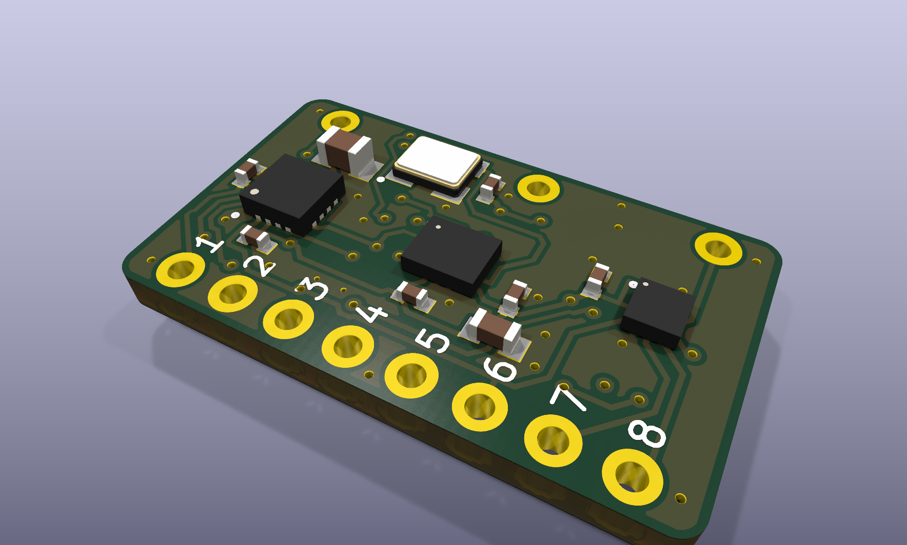
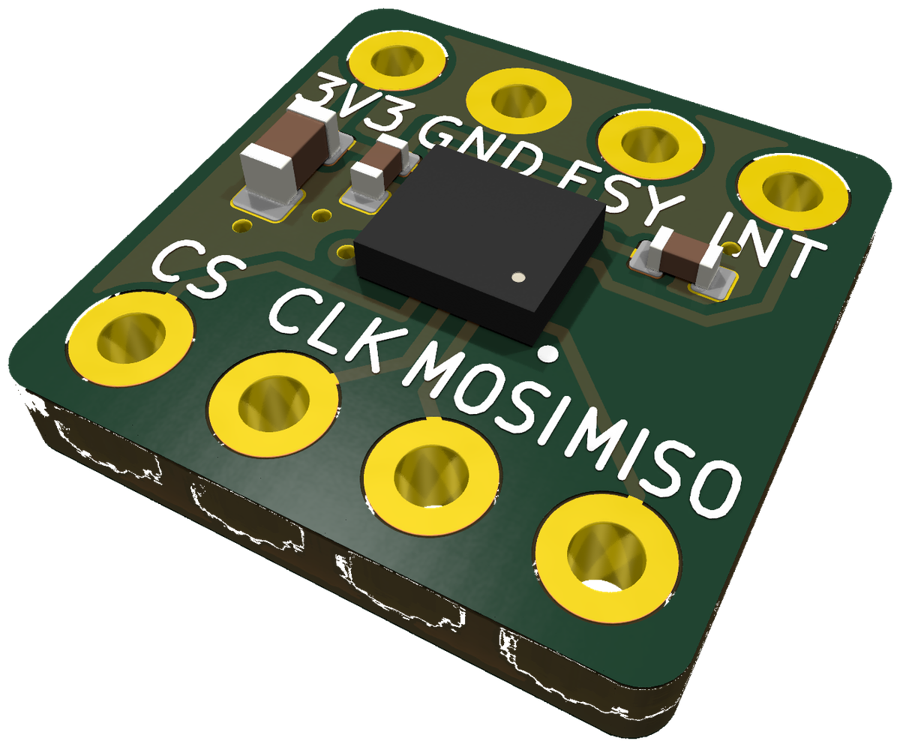

# Прошивки, програми й документація до плат

[English](README.md)

Невеликі плати для мейкерів. Кожна плата продається окремо, а все, щоб нею користуватися, разом із сирцями, лежить тут безкоштовно. У кожного продукту своя тека.

Сторінки продуктів: https://vdoom.github.io/boards/

| Продукт | Що це | Документація |
|---|---|---|
|  [**INS10-A3**](ins10-a3/README.uk.md) | Датчик орієнтації 10-DoF для Raspberry Pi Pico (ICM-42688-P, MMC5983MA, LPS22DF). Прошивка з фільтром Калмана, додаток калібрування INS10 Studio для Windows і підставка під 3D-друк | [Посібник](ins10-a3/docs/uk/user-guide.md) · [Технічний опис](ins10-a3/docs/uk/datasheet.md) |
|  [**I42688-A**](i42688-a/README.uk.md) | Плата 6-осьового IMU 10,5 × 10,5 мм (ICM-42688-P). Стає в макетну плату, SPI або I²C, 1,8–3,3 В | [Розпіновка, підключення, перше читання](i42688-a/README.uk.md) |

## Завантаження

Готові файли (образи прошивки, програми для Windows, STL) — на сторінці **Releases** цього репозиторію. Назва кожного релізу починається з назви теки продукту, наприклад `ins10-a3-v1.0.0`. Щоб побачити файли одного продукту, введіть назву його теки в пошук релізів.

## Ліцензія

Прошивки й програми відкриті за ліцензією з файлу `LICENSE`, якщо в теці продукту не сказано інакше. Їх можна змінювати під свої проєкти.

## Питання

Пишіть на {{SUPPORT_EMAIL}} або відкрийте issue тут. Будь ласка, вкажіть у заголовку назву продукту.
