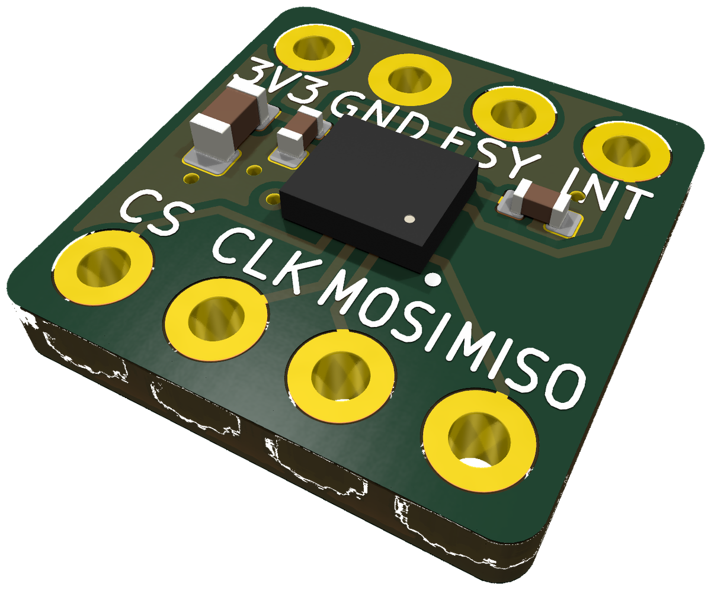
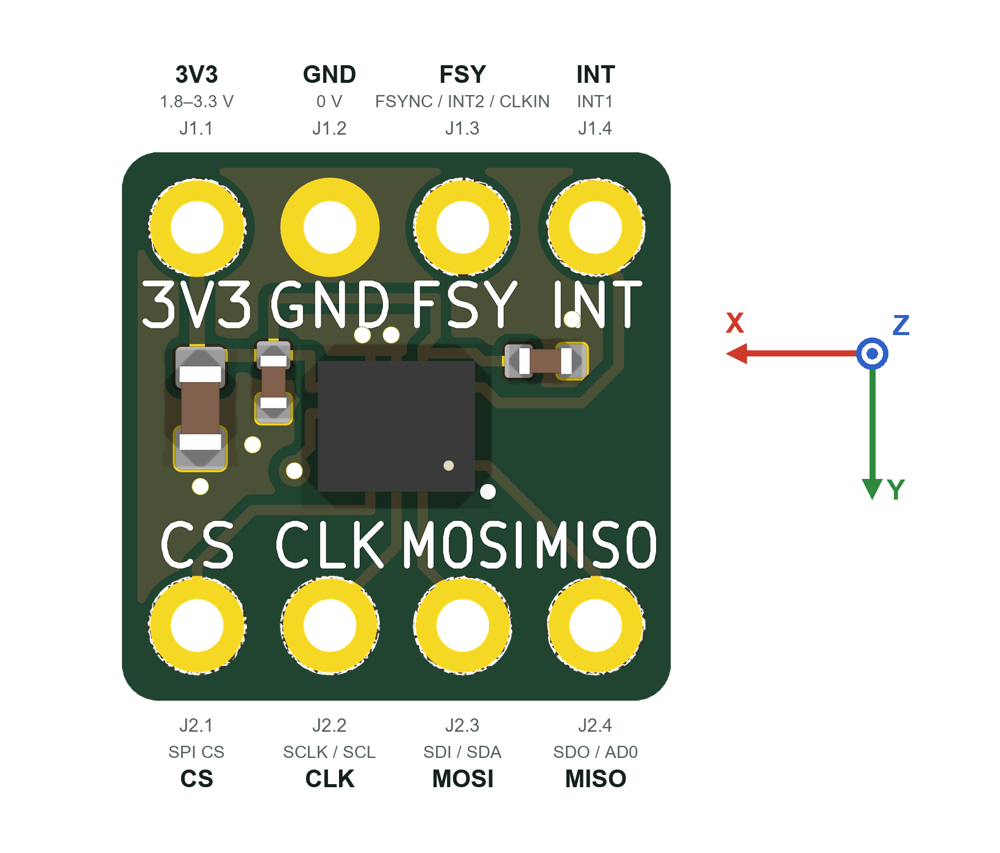
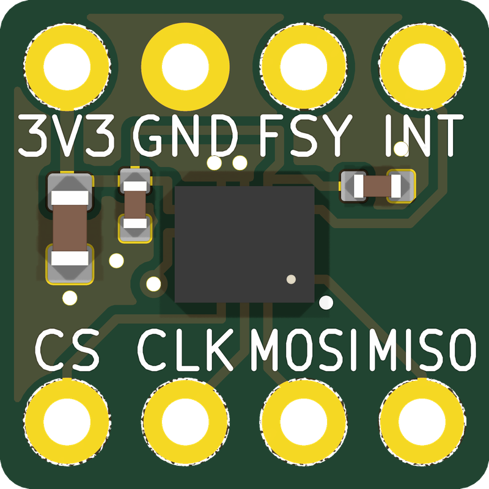
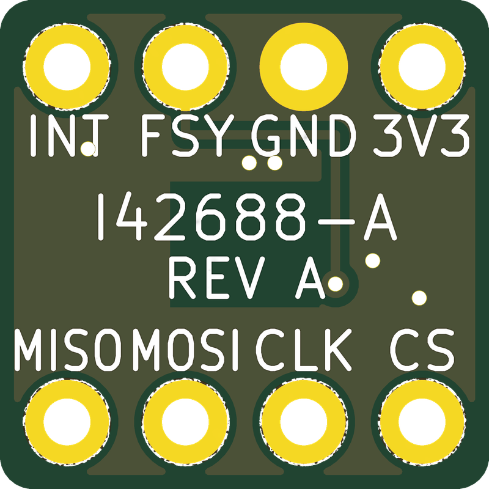

# I42688-A: 6-axis IMU breakout with the ICM-42688-P

[All products](../README.md) · [Українська](README.uk.md)

A 10.5 × 10.5 mm board with the TDK InvenSense ICM-42688-P, a low-noise 6-axis gyroscope and accelerometer, plus its bypass capacitors and nothing else. The eight pins sit in two rows 7.62 mm apart, so the board plugs into a breadboard like an 8-pin chip or solders onto your own board with pin headers. It talks SPI or I²C at 1.8–3.3 V.

| | |
|---|---|
| Sensor | Gyroscope ±15.6…±2000 °/s, accelerometer ±2…±16 g, output data rate up to 32 kHz, temperature sensor |
| Interface | SPI up to 24 MHz, or I²C up to 1 MHz |
| Supply | 1.8–3.3 V, max 3.6 V; logic at the supply voltage; not 5 V tolerant |
| Size | 10.5 × 10.5 × 1.6 mm, 2 × 4 holes at 2.54 mm pitch, rows 7.62 mm apart |

## Pinout

| Header | Label | ICM-42688-P pin | Function |
|---|---|---|---|
| J1.1 | 3V3 | 5 VDDIO, 8 VDD | Supply, 1.8–3.3 V |
| J1.2 | GND | 6, 7 | Ground |
| J1.3 | FSY | 9 | FSYNC input, INT2 output or 31–50 kHz clock input. Connect to GND when unused |
| J1.4 | INT | 4 | INT1 output |
| J2.1 | CS | 12 | SPI chip select, active low. Tie to 3V3 for I²C |
| J2.2 | CLK | 13 | SPI clock / I²C SCL |
| J2.3 | MOSI | 14 | SPI data in / I²C SDA |
| J2.4 | MISO | 1 | SPI data out / I²C address bit (AD0) |

The board has no regulator, level shifter or pull-up resistors: your microcontroller is wired straight to the sensor. VDD has 2.2 µF and 100 nF, VDDIO 10 nF, as TDK recommends.

## Sensing axes

Looking at the component side with the 3V3 row at the top:

- **X** points to the left, towards the 3V3 and CS edge;
- **Y** points down, from the 3V3 row towards the CS row;
- **Z** points out of the component side, towards you.

A quick check in your own code: with the board lying flat, components up, the accelerometer reads Z ≈ +1 g; standing on its INT/MISO edge, X ≈ +1 g; standing on the 3V3 row, Y ≈ +1 g.

## Wiring

### SPI

SPI mode 0 or 3, MSB first, up to 24 MHz. Keep CS high between transfers. Example for a Raspberry Pi Pico on SPI0:

| Board | Raspberry Pi Pico | Pico pin |
|---|---|---|
| 3V3 | 3V3(OUT) | 36 |
| GND | GND | 23 |
| FSY | GND | 23 |
| INT | GP20 (optional) | 26 |
| CS | GP17 | 22 |
| CLK | GP18, SPI0 SCK | 24 |
| MOSI | GP19, SPI0 TX | 25 |
| MISO | GP16, SPI0 RX | 21 |

FSY can also be tied to GND right at the board. Never power the board from VBUS or VSYS: that is 5 V.

### I²C

- CS to 3V3.
- MISO selects the address: GND gives 0x68, 3V3 gives 0x69.
- Pull-ups to 3V3 on CLK (SCL) and MOSI (SDA), for example 4.7 kΩ. The board has none.
- The recommended interface settings for I²C are in datasheet section 12.3.

### Interrupt pin

After reset, INT is a pulsed, active-low, open-drain output, so it needs a pull-up. To get a push-pull, active-high, latched INT1, write `0x07` to INT_CONFIG (`0x14`). The datasheet (section 12.6) also asks you to clear bit 4, INT_ASYNC_RESET, of INT_CONFIG1 (`0x64`) before you use interrupts.

## First reading over SPI

All registers below are in bank 0, which is selected after reset.

1. Wait 1 ms after power-up.
2. Read WHO_AM_I (`0x75`): send `0xF5` (the address with bit 7 set for a read), then one dummy byte. The answer is `0x47`.
3. Switch the gyroscope and accelerometer on in low-noise mode: write `0x0F` to PWR_MGMT0 (`0x4E`). Do not write any register for 200 µs after that. The gyroscope gives valid data after about 30 ms.
4. Read 14 bytes starting at TEMP_DATA1 (`0x1D`): temperature, then accelerometer X, Y, Z, then gyroscope X, Y, Z. Each value is a signed 16-bit number, high byte first.
5. Convert. After reset the ranges are ±16 g and ±2000 °/s at 1 kHz:
   - acceleration, g = value / 2048;
   - rotation rate, °/s = value / 16.4;
   - temperature, °C = value / 132.48 + 25.

To change range and rate, write GYRO_CONFIG0 (`0x4F`) and ACCEL_CONFIG0 (`0x50`): bits 7:5 select the range, bits 3:0 the output data rate. The full register map, the FIFO, the filters and the motion functions are described in the [ICM-42688-P datasheet](https://www.invensense.tdk.com/en-us/products/6-axis/icm-42688-p).

## Software

The ICM-42688-P is a widely used sensor. Zephyr, PX4, ArduPilot and Betaflight support it, and so do several Arduino libraries. Use any of them with the pinout above.

## Specifications

| | |
|---|---|
| Gyroscope | ±15.6…±2000 °/s; noise 2.8 mdps/√Hz, 0.028 °/s RMS in a 100 Hz band; sensitivity tolerance ±0.5 %; offset drift ±0.005 °/s/°C; 12.5 Hz…32 kHz |
| Accelerometer | ±2…±16 g; noise 65 µg/√Hz (X, Y), 70 µg/√Hz (Z), 0.65 mg RMS in a 100 Hz band; sensitivity tolerance ±0.5 %; offset drift ±0.15 mg/°C; 1.56 Hz…32 kHz |
| Data | 16-bit registers; 2 kB FIFO with a 20-bit format (19-bit gyroscope, 18-bit accelerometer, at ±2000 °/s and ±16 g) |
| Extras | Programmable anti-alias and notch filters; tap, tilt, step counting and wake-on-motion in the chip; external clock input 31–50 kHz on FSY |
| Supply current | 0.88 mA with 6 axes in low-noise mode; 7.5 µA asleep |
| Interface | SPI up to 24 MHz (mode 0 or 3); I²C up to 1 MHz |
| Operating temperature | −40…+85 °C (sensor rating) |

Sensor figures are typical values from the TDK datasheet.

## Dimensions

| | |
|---|---|
| Board | 10.5 × 10.5 mm, 1.6 mm FR-4, corners R0.7 mm, no mounting holes |
| Holes | 8 plated holes, Ø1.0 mm, pads Ø1.8 mm |
| Hole centres | From the upper-left corner, component side, 3V3 row at the top: X = 1.44, 3.98, 6.52, 9.06 mm; Y = 1.44 mm (3V3 row) and 9.06 mm (CS row) |
| Parts | All on the component side; the sensor is the tallest at 0.91 mm |
| Headers | Not soldered; two 1 × 4 headers at 2.54 mm pitch fit |

| Component side | Back |
|---|---|
|  |  |

## Safety

I42688-A is a development board for makers and engineers. It is not certified for aviation, medical, automotive or other safety-critical use. Never exceed 3.6 V. It is sensitive to static electricity and contains small parts; keep it away from children.

## Folder contents

| Path | What |
|---|---|
| `images` | Render, pinout with axes, component side and back |
