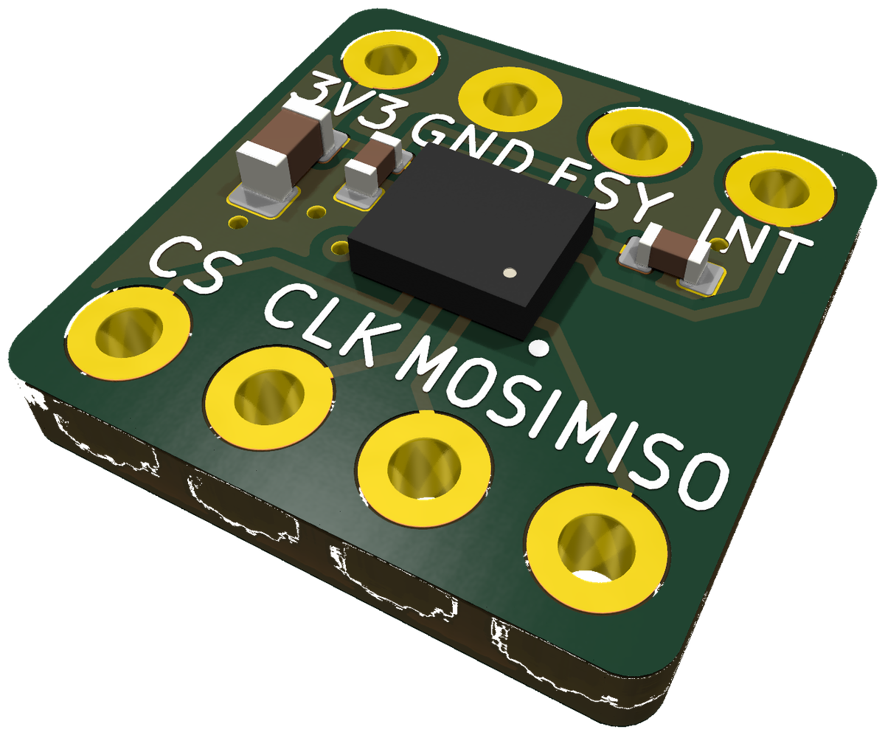
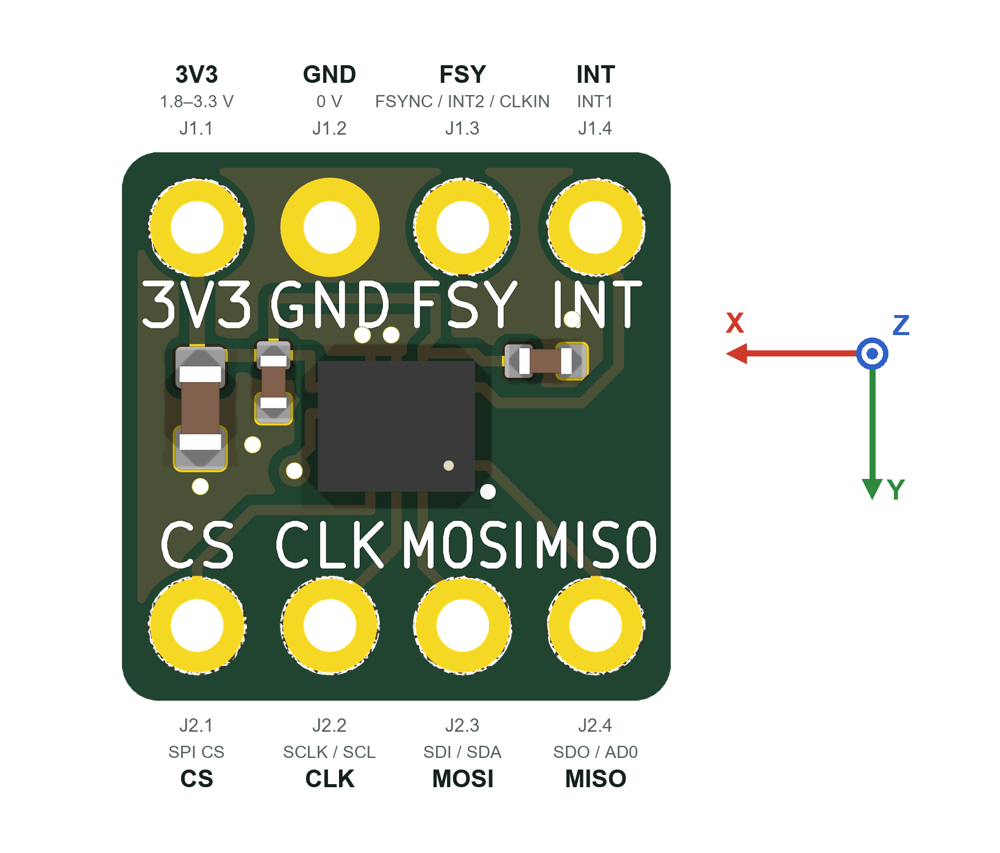
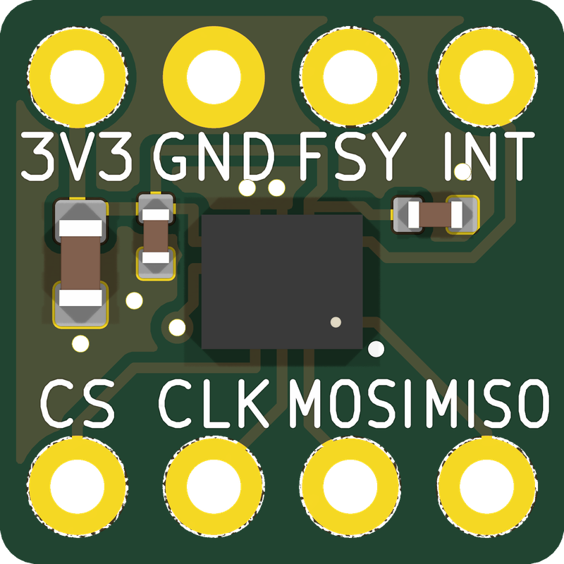
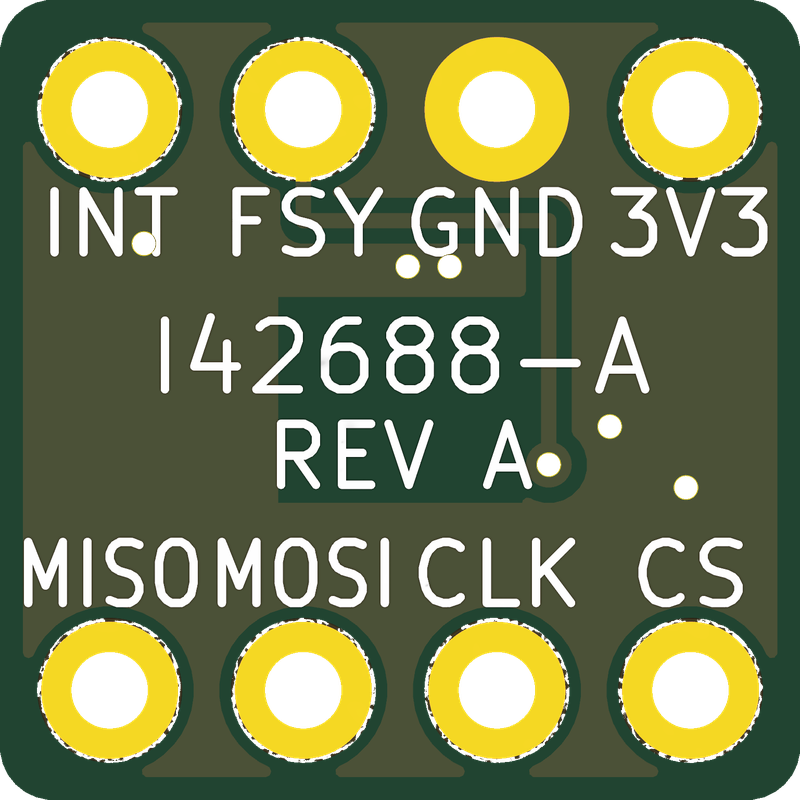

# I42688-A: плата 6-осьового IMU з ICM-42688-P

[Усі продукти](../README.uk.md) · [English](README.md)

Плата 10,5 × 10,5 мм з TDK InvenSense ICM-42688-P — малошумними 6-осьовими гіроскопом і акселерометром — та блокувальними конденсаторами, і більше нічого. Вісім виводів стоять у два ряди на відстані 7,62 мм, тож плата вставляється в макетну плату, як 8-вивідна мікросхема, або паяється на вашу плату на штирях. Зв'язок через SPI або I²C при 1,8–3,3 В.

| | |
|---|---|
| Сенсор | Гіроскоп ±15,6…±2000 °/с, акселерометр ±2…±16 g, частота даних до 32 кГц, датчик температури |
| Інтерфейс | SPI до 24 МГц або I²C до 1 МГц |
| Живлення | 1,8–3,3 В, не більше 3,6 В; логіка на рівні живлення; 5 В не витримує |
| Розмір | 10,5 × 10,5 × 1,6 мм, 2 × 4 отвори з кроком 2,54 мм, ряди за 7,62 мм |

## Розпіновка

| Контакт | Напис | Вивід ICM-42688-P | Призначення |
|---|---|---|---|
| J1.1 | 3V3 | 5 VDDIO, 8 VDD | Живлення 1,8–3,3 В |
| J1.2 | GND | 6, 7 | Земля |
| J1.3 | FSY | 9 | Вхід FSYNC, вихід INT2 або вхід тактування 31–50 кГц. Якщо не використовується — на GND |
| J1.4 | INT | 4 | Вихід INT1 |
| J2.1 | CS | 12 | Вибір мікросхеми SPI, активний низький. Для I²C — на 3V3 |
| J2.2 | CLK | 13 | Такт SPI / I²C SCL |
| J2.3 | MOSI | 14 | Вхід даних SPI / I²C SDA |
| J2.4 | MISO | 1 | Вихід даних SPI / біт адреси I²C (AD0) |

На платі немає стабілізатора, перетворювача рівнів чи підтягувальних резисторів: мікроконтролер з'єднано із сенсором напряму. На VDD стоять 2,2 мкФ і 100 нФ, на VDDIO — 10 нФ, як радить TDK.

## Осі

Вигляд із боку компонентів, ряд 3V3 угорі:

- **X** спрямована ліворуч, до краю з 3V3 і CS;
- **Y** спрямована вниз, від ряду 3V3 до ряду CS;
- **Z** спрямована з боку компонентів, на вас.

Швидка перевірка у вашому коді: плата лежить компонентами вгору — акселерометр показує Z ≈ +1 g; стоїть на ребрі з INT і MISO — X ≈ +1 g; стоїть на ряду 3V3 — Y ≈ +1 g.

## Підключення

### SPI

Режим SPI 0 або 3, старший біт першим, до 24 МГц. Між передачами тримайте CS високим. Приклад для Raspberry Pi Pico на SPI0:

| Плата | Raspberry Pi Pico | Вивід Pico |
|---|---|---|
| 3V3 | 3V3(OUT) | 36 |
| GND | GND | 23 |
| FSY | GND | 23 |
| INT | GP20 (за бажанням) | 26 |
| CS | GP17 | 22 |
| CLK | GP18, SPI0 SCK | 24 |
| MOSI | GP19, SPI0 TX | 25 |
| MISO | GP16, SPI0 RX | 21 |

FSY можна з'єднати з GND і просто на платі. Ніколи не живіть плату від VBUS чи VSYS: там 5 В.

### I²C

- CS — на 3V3.
- MISO задає адресу: GND — 0x68, 3V3 — 0x69.
- Підтяжки до 3V3 на CLK (SCL) і MOSI (SDA), наприклад 4,7 кОм. На платі їх немає.
- Рекомендовані налаштування інтерфейсу для I²C наведено в розділі 12.3 даташита.

### Вивід переривання

Після скидання INT — імпульсний вихід із відкритим стоком і активним низьким рівнем, тож йому потрібна підтяжка. Щоб отримати двотактний INT1 з активним високим рівнем і фіксацією, запишіть `0x07` в INT_CONFIG (`0x14`). Даташит (розділ 12.6) також вимагає перед використанням переривань скинути біт 4, INT_ASYNC_RESET, регістра INT_CONFIG1 (`0x64`).

## Перше читання через SPI

Усі регістри нижче — у банку 0, який вибрано після скидання.

1. Після ввімкнення живлення зачекайте 1 мс.
2. Прочитайте WHO_AM_I (`0x75`): надішліть `0xF5` (адреса з бітом 7 для читання), потім один порожній байт. Відповідь — `0x47`.
3. Увімкніть гіроскоп і акселерометр у малошумному режимі: запишіть `0x0F` у PWR_MGMT0 (`0x4E`). Після цього 200 мкс не пишіть у жоден регістр. Гіроскоп дає правильні дані приблизно через 30 мс.
4. Прочитайте 14 байтів, починаючи з TEMP_DATA1 (`0x1D`): температура, потім акселерометр X, Y, Z, потім гіроскоп X, Y, Z. Кожне значення — 16-бітне число зі знаком, старший байт першим.
5. Перерахуйте. Після скидання діапазони ±16 g і ±2000 °/с, частота 1 кГц:
   - прискорення, g = значення / 2048;
   - кутова швидкість, °/с = значення / 16,4;
   - температура, °C = значення / 132,48 + 25.

Діапазон і частоту змінюють регістри GYRO_CONFIG0 (`0x4F`) і ACCEL_CONFIG0 (`0x50`): біти 7:5 задають діапазон, біти 3:0 — частоту даних. Повну карту регістрів, FIFO, фільтри й функції виявлення руху описано в [даташиті ICM-42688-P](https://www.invensense.tdk.com/en-us/products/6-axis/icm-42688-p).

## Програми

ICM-42688-P — поширений сенсор. Його підтримують Zephyr, PX4, ArduPilot і Betaflight, а також кілька бібліотек для Arduino. Будь-яку з них можна використати з розпіновкою вище.

## Характеристики

| | |
|---|---|
| Гіроскоп | ±15,6…±2000 °/с; шум 2,8 м°/с/√Гц, 0,028 °/с СКВ у смузі 100 Гц; допуск чутливості ±0,5 %; дрейф зсуву ±0,005 °/с/°C; 12,5 Гц…32 кГц |
| Акселерометр | ±2…±16 g; шум 65 мкg/√Гц (X, Y), 70 мкg/√Гц (Z), 0,65 мg СКВ у смузі 100 Гц; допуск чутливості ±0,5 %; дрейф зсуву ±0,15 мg/°C; 1,56 Гц…32 кГц |
| Дані | 16-бітні регістри; FIFO на 2 КБ із 20-бітним форматом (гіроскоп 19 біт, акселерометр 18 біт, на ±2000 °/с і ±16 g) |
| Додатково | Програмовані антиаліасинговий і режекторний фільтри; виявлення дотику, нахилу, кроків і руху в самій мікросхемі; вхід тактування 31–50 кГц на FSY |
| Струм | 0,88 мА з 6 осями в малошумному режимі; 7,5 мкА у сні |
| Інтерфейс | SPI до 24 МГц (режим 0 або 3); I²C до 1 МГц |
| Робоча температура | −40…+85 °C (межа сенсора) |

Характеристики сенсора — типові значення з даташита TDK.

## Розміри

| | |
|---|---|
| Плата | 10,5 × 10,5 мм, FR-4 1,6 мм, кути R0,7 мм, без кріпильних отворів |
| Отвори | 8 металізованих отворів Ø1,0 мм, площадки Ø1,8 мм |
| Центри отворів | Від лівого верхнього кута, вигляд із боку компонентів, ряд 3V3 угорі: X = 1,44; 3,98; 6,52; 9,06 мм; Y = 1,44 мм (ряд 3V3) і 9,06 мм (ряд CS) |
| Деталі | Усі з боку компонентів; найвищий — сенсор, 0,91 мм |
| Штирі | Не впаяні; підходять дві гребінки 1 × 4 з кроком 2,54 мм |

| Бік компонентів | Зворот |
|---|---|
|  |  |

## Безпека

I42688-A — плата для розробників і мейкерів. Вона не сертифікована для авіації, медицини, автомобілів чи інших відповідальних застосувань. Не перевищуйте 3,6 В. Плата чутлива до статичної електрики й містить дрібні деталі; тримайте її подалі від дітей.

## Вміст теки

| Шлях | Що |
|---|---|
| `images` | Рендер, розпіновка з осями, бік компонентів і зворот |
