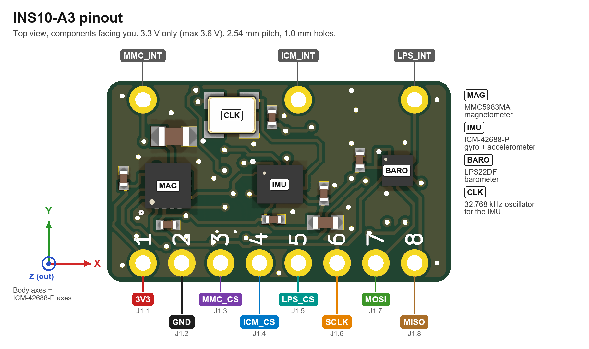
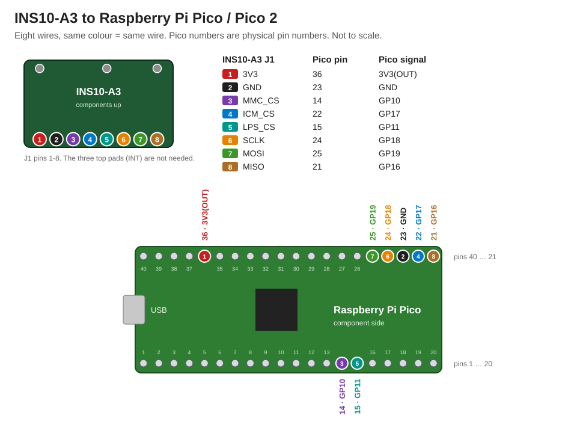
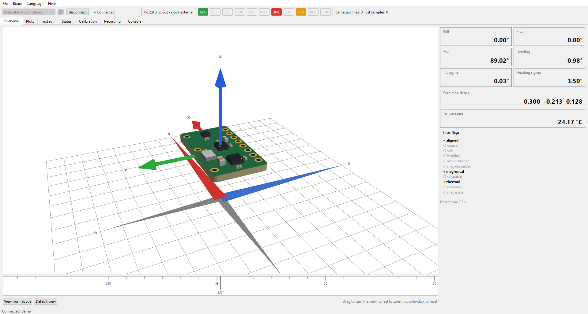
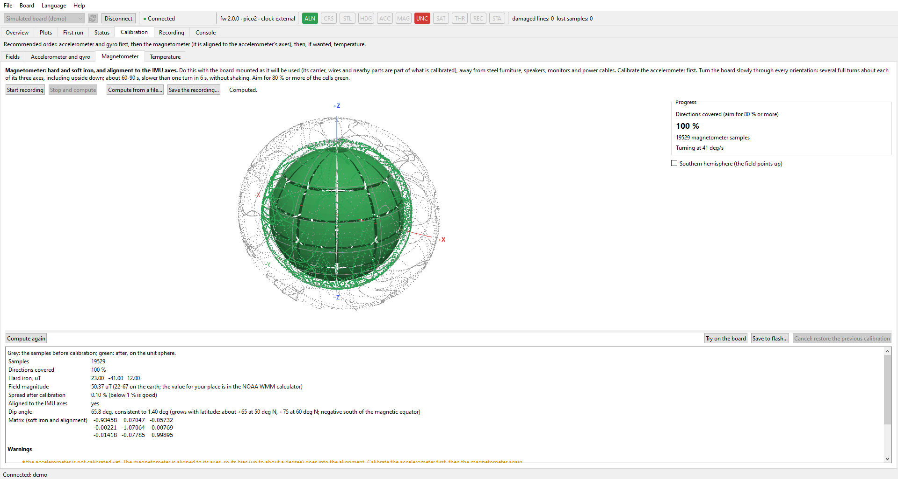

# INS10-A3: 10-DoF orientation sensor for Raspberry Pi Pico

[All products](../README.md) · [Українська](README.uk.md)

A 22.5 × 13.2 mm module with a 6-axis IMU (ICM-42688-P), a 3-axis magnetometer (MMC5983MA) and a barometer (LPS22DF) on one SPI bus. A 32.768 kHz oscillator clocks the IMU at exactly 512 Hz. Wire it to a Pico or Pico 2, flash the free firmware, and get a full 360° orientation over USB. Then calibrate it step by step in the free INS10 Studio app, on a jig you print yourself.

| | |
|---|---|
| Sensors | Gyroscope ±2000 °/s, accelerometer ±16 g (20-bit), magnetometer ±8 G (18-bit), barometer 260–1260 hPa |
| Output | Quaternion, roll, pitch, yaw, compass heading, uncertainties, raw data; up to 200 Hz orientation over USB |
| Filter | Extended Kalman filter at 512 Hz with gyro bias tracking, temperature compensation and adaptive rejection of accelerations and magnetic disturbances |
| Interface | SPI, 3.3 V, 8 wires to the Pico |
| Software | Open-source firmware for Pico/Pico 2 and INS10 Studio for Windows |

## Documentation

| Document | English | Українською |
|---|---|---|
| Getting started: wiring, flashing, Studio, calibration, troubleshooting | [User guide](docs/en/user-guide.md) | [Посібник](docs/uk/user-guide.md) |
| Specifications, pinout, dimensions, axes | [Datasheet](docs/en/datasheet.md) | [Технічний опис](docs/uk/datasheet.md) |
| USB commands and data streams | [Protocol](docs/en/protocol.md) | [Протокол](firmware/docs/PROTOCOL.md) |
| Calibration jig: print, assemble, change sizes | [User guide, section 8](docs/en/user-guide.md#8-print-and-assemble-the-calibration-jig) | [README підставки](calibration-jig/README.md) |

Developer documentation (in Ukrainian): [firmware](firmware/README.md), [filter algorithms](firmware/docs/ALGORITHMS.md), [INS10 Studio](studio/README.md).

## Pictures

| | |
|---|---|
|  |  |
|  |  |

## Ready-made files

The firmware for Pico and Pico 2 (`.uf2`) and INS10 Studio for Windows (`.zip`) are on this repository's **Releases** page, in the releases whose names start with `ins10-a3`. To change them, build them from the sources here: see the [firmware](firmware/README.md) and [INS10 Studio](studio/README.md) READMEs.

## Folder contents

| Path | What |
|---|---|
| `firmware` | The `ins10_ahrs` firmware: sources, build scripts, host tests, the fusion library (portable C11) and the Python calibration tool |
| `studio` | INS10 Studio: C++20/Qt 6 sources, tests, build and deployment scripts |
| `calibration-jig` | The calibration jig: STL files to print, STEP, the FreeCAD model and the script that generates them |
| `docs/en`, `docs/uk` | Buyer documentation |
| `images` | Renders, pinout, wiring diagram, Studio screenshots, jig preview |
