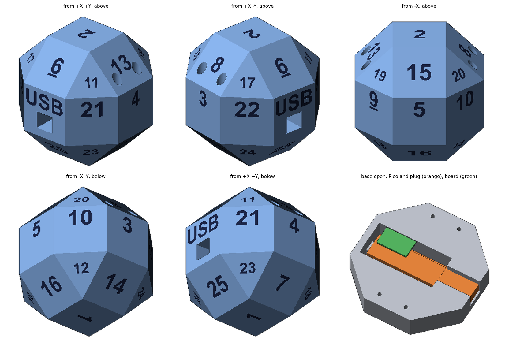

# Підставка для калібрування INS10-A3

Двадцятишестигранник 85 мм: куб, у якого зрізано всі ребра й кути (ромбокубооктаедр). Плата INS10-A3 і Raspberry Pi Pico лежать усередині разом із дротами, якими вони вже спаяні, і рухаються як одне ціле. Кожна грань — окреме стійке положення для калібрування акселерометра й гіроскопа.

Підставка складається з двох деталей, які скручуються чотирма гвинтами M3 × 16:
- **основа** — нижня половина. Pico лежить на рейці в її порожнині, а штекер USB — у каналі, що виходить через одну бічну грань;
- **кришка** — верхня половина. Плата приклеєна голим зворотом у неглибоку заглибину на нижньому боці кришки, сенсорами вниз, до Pico.

Так плата лежить сенсорами до Pico, як і спаяна, тож дроти не треба ні перепаювати, ні загинати. Плата висить просто над тим кінцем Pico, куди йде більшість дротів. Найдовшому дроту потрібно близько 3 см, а найкоротший у вас — 5 см.

На гранях вигравірувано номери від 1 до 25, на кабельній — «USB». Номер — це положення: «покладіть на 7» означає числом 7 донизу.

Підтримки при друку не потрібні. Металу в підставці немає, крім гвинтів.



## Файли

| Файл | Що це |
|---|---|
| `calibration-jig-base.stl` | Основа, для слайсера |
| `calibration-jig-lid.stl` | Кришка, для слайсера |
| `calibration-jig.step` | Обидві деталі для інших CAD |
| `calibration-jig.FCStd` | FreeCAD: обидві деталі та спрощені моделі плати, Pico, штекера, гребінок і гвинтів у групі `Reference_not_printed` (їх не друкувати) |
| `calibration_jig.py` | Параметрична модель; усі розміри — на початку файлу |
| `build.ps1` | Перебудовує файли й перевіряє, що все вміщується |

**Кабельна грань** — та, на якій написано «USB» і з якої виходить кабель.

## Що знадобиться

- **4 гвинти M3 × 16** з циліндричною головкою (до 6 мм). Вони самі нарізають різьбу в пластику основи.
  - Найкраще підходять латунні або нейлонові.
  - Звичайні сталеві теж підійдуть: вони щонайменше за 3 см від магнітометра й не рухаються відносно нього, тож калібрування магнітометра їх урахує.
- **Тонкий двосторонній скотч.** Спінений не годиться: він пружинить.

Вимірювати штекер не обов'язково: довший за 25 мм просто трохи вийде з кабельної грані. Гребінки на Pico теж не заважають: під нею 9 мм вільного місця, а штирі мають 8,5 мм.

## Друк

- Пластик PLA або PETG, шар 0,2 мм, 3 периметри, заповнення 15%. Обидві деталі разом — близько 100 г.
- **Основа** — як у файлі: гранню з номером 1 на стіл. Цифра на ній вигравірувана в перших шарах, тож так і має бути.
- **Кришка** — як у файлі: пласким боком із заглибиною на стіл. Найбільше нависання — місток 14 мм над заглибиною для плати.
- Цифри вигравірувані на 0,6 мм углиб. Грані лишаються пласкими, і на бічних гранях цифри друкуються без підтримок.
- Якщо плата не лізе в заглибину, підшліфуйте її або задайте `BOARD_CLEAR = 0.35` і передрукуйте кришку.

## Збирання

1. **Підготуйте Pico.** Від'єднайте кабель від комп'ютера й вставте штекер у Pico.
2. **Наклейте скотч на рейку основи.** Знадобиться смужка двостороннього скотчу.
3. **Приклейте плату до кришки.**
   - Покладіть кришку на стіл заглибиною догори. Наклейте скотч на голий зворот плати.
   - Вкладіть плату в заглибину сенсорами догори, тобто від кришки.
   - Край із J1 має дивитися до середини кришки, а кінець J1 з контактом J1.1 (3V3) — до кінця заглибини, ближчого до центру. Тоді дроти найкоротші. Навпаки теж вміститься, але найдовшому дроту знадобиться майже 5 см.
4. **Покладіть Pico в основу.**
   - Переверніть кришку: плата тепер дивиться вниз, Pico висить на дротах.
   - Покладіть Pico на рейку роз'ємом USB до кабельної грані й притисніть до скотчу.
   - Укладіть кабель у канал.
5. **Закрийте підставку.**
   - Складіть дроти в порожнину й опустіть кришку на основу так, щоб отвори збіглися.
   - Подивіться, чи не затиснуто дріт і чи кришка лягла без щілини.
   - Закрутіть 4 гвинти, не перетягуючи: різьба в пластику.

## Номери граней

Номер на грані означає положення, у якому ця грань лежить на столі. Покласти «на 7» — означає повернути підставку числом 7 донизу. Числа не повторюються. 6 і 9 підкреслені, як на гральних кубиках, щоб їх не сплутати.

| Номери | Які грані | Кабель |
|---|---|---|
| 1–5 | Квадратні: 1 — дно основи (звичайне положення), 2 — верх кришки, 3 і 4 — бічні, 5 — навпроти кабельної | Не заважає |
| 6–20 | Скошені ребра (прямокутники) і кути (трикутники) | Виходить високо над столом і не заважає |
| 21–25 | Ребра й кути поруч із кабельною гранню | Виходить низько над столом і мусить різко загнутися, на 25 — найнижче. Жорсткий кабель може підважити підставку; тоді пропустіть ці положення |
| USB | Кабельна грань | На неї не класти |

Номери розставлено так, що будь-які перші з них вже дають положення в усіх напрямках. Тож можна просто йти по порядку: 1, 2, 3 і далі.

## Як користуватися

- **Вібрація.** Якщо стіл вібрує від вентиляторів, покладіть під підставку важку основу на м'якому шарі.
- **Калібрування акселерометра й гіроскопа.**
  - Кладіть по черзі на грані 1, 2, 3… щонайменше до 12. Краще пройти до 20, а якщо кабель м'який — до 25.
  - На кожній — 3–4 с, не торкаючись підставки.
  - Між гранями — один плавний поворот; при переході до наступного номера вісь повороту змінюється сама.
- **Перевірка осей магнітометра.** Покладіть на грані з 1 до 10, по 5 с на кожній.
- **Калібрування магнітометра.** Тримайте підставку в руці й повільно обертайте її в усіх напрямках, далеко від комп'ютерів. Підставка, Pico, дроти й гвинти теж впливають на поле, тож калібрування враховує і їх. Якщо потім плату змонтуєте інакше, калібрування магнітометра доведеться повторити.
- **Вирівнювання осей.** Pico лежить уздовж осі X підставки, роз'ємом до кабельної грані (+X). Плата лежить уздовж тієї самої осі, сенсорами вниз (−Z). Як осі ICM-42688-P лежать відносно контуру плати, ще не підтверджено. Для калібрування це не важливо: воно не вимагає, щоб грані збігалися з осями сенсора.

## Зміна розмірів

Усі розміри задано на початку `calibration_jig.py`. Головні:

| Параметр | Типово | Зміст |
|---|---:|---|
| `SIZE` | 85 | Відстань між протилежними квадратними гранями, мм |
| `PLUG_LEN` | 25 | Жорстка частина штекера USB; від неї залежить, наскільки Pico відсунуто від кабельної грані, мм |
| `BOARD_CLEAR` | 0,25 | Зазор заглибини для плати на бік, мм |
| `PICO_Z` | −10 | Висота нижнього боку Pico; від неї залежить відстань між Pico і платою, мм |
| `BELOW` | 9 | Місце під Pico для штирів гребінки, мм |
| `WIRE_MIN` | 50 | Найкоротший дріт між платою і Pico; перевірка не пропустить довший шлях, мм |
| `SCREW_LEN` | 16 | Довжина гвинтів, мм |

Після змін запустіть:

```powershell
./build.ps1
```

Скрипт:
- перебудовує обидва STL, STEP, FCStd і `preview.png`;
- перевіряє, що плата, Pico, гребінки, штекер і гвинти ні в що не впираються, що головки гвинтів утоплені, що деталі друкуються без підтримок і що всі 26 граней на місці;
- перевіряє, що кожен номер уміщується на своїй грані й не зачіпає отворів, а номери 1–25 не повторюються (їх задає `FACE_NUMBERS`);
- рахує, якої довжини потрібні дроти.

Якщо щось не вміщується, файли не перезаписуються. Потрібен FreeCAD 1.0 або 1.1. Модель можна також відкрити у FreeCAD як макрос: Macro → Macros… → Execute.
