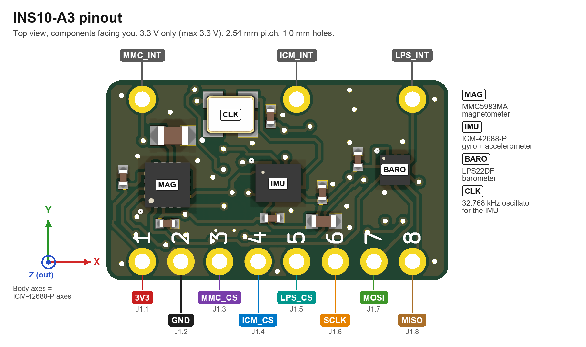

# INS10-A3 datasheet

**10-degree-of-freedom orientation sensor module: 3-axis gyroscope, 3-axis accelerometer, 3-axis magnetometer and barometer on one 22.5 × 13.2 mm board, with an external 32.768 kHz clock for the IMU.**

Revision A3 · document version 1.0 · [Українська версія](../uk/datasheet.md)

*3D render of the board. Photos of the real module are on the product page.*

## Overview

INS10-A3 carries three sensors on one SPI bus:

- **ICM-42688-P** (TDK InvenSense): 6-axis IMU, the gyroscope and accelerometer.
- **MMC5983MA** (MEMSIC): 3-axis magnetometer.
- **LPS22DF** (STMicroelectronics): barometric pressure sensor.

A 32.768 kHz CMOS oscillator drives the IMU's CLKIN pin. The IMU then samples at exactly 512 Hz from a ±25 ppm reference instead of its internal RC oscillator, which makes gyro integration and timestamps predictable.

The module is meant to be wired to a Raspberry Pi Pico or Pico 2 running the open-source **ins10_ahrs** firmware. The firmware turns the raw data into a full 360° orientation (quaternion, roll, pitch, yaw and compass heading) and sends it over USB. **INS10 Studio** is the companion desktop app for viewing, checking and calibrating the module. You can also drive the sensors from your own microcontroller: the pinout and register-level notes below are enough.

## Features

- Three sensors, 10 measured axes: rotation rate, acceleration and magnetic field in X, Y and Z, plus pressure. Each sensor also reports its temperature.
- IMU clocked from an external 32.768 kHz oscillator: output data rate exactly 512 Hz.
- 4-wire SPI with three chip selects; three separate interrupt outputs.
- 3.3 V supply and logic, no regulator, no pull-ups, no level shifters: small and quiet.
- 22.5 × 13.2 mm, two layers, 2.54 mm pitch through-holes.
- Free firmware for Pico and Pico 2: extended Kalman filter at 512 Hz, adaptive rejection of accelerations and magnetic disturbances, gyro bias tracking, temperature compensation, calibration stored in flash.
- Free desktop app for Windows (INS10 Studio): live 3D view, plots, health checks, step-by-step calibration wizards, recording and replay.
- Printable calibration jig (STL) with 25 numbered resting faces.

## Specifications

### Sensors

| Sensor | Part | Range used by the firmware | Resolution | Key figures from the manufacturer's datasheet |
|---|---|---|---|---|
| Gyroscope | ICM-42688-P | ±2000 °/s | 20-bit FIFO, 0.0038 °/s per LSB | Noise 2.8 mdps/√Hz |
| Accelerometer | ICM-42688-P | ±16 g | 20-bit FIFO, 30.5 µg per LSB | Noise 70 µg/√Hz |
| Magnetometer | MMC5983MA | ±8 G (±800 µT) | 18-bit | 0.4 mG total RMS noise; built-in SET/RESET to remove bridge offset |
| Barometer | LPS22DF | 260–1260 hPa | 24-bit | Absolute accuracy ±0.5 hPa, noise 0.34 Pa RMS |
| IMU clock | ECS-327MVATX-3 | 32.768 kHz CMOS | — | ±25 ppm overall tolerance |

The chips support other ranges and rates; the table shows what the supplied firmware uses. The magnetometer's full-scale range is far above the Earth's field (25–65 µT), which leaves room for hard-iron offsets from nearby parts.

### Data rates with the ins10_ahrs firmware

| Output | Rate |
|---|---|
| IMU sampling (gyro + accelerometer) | 512 Hz |
| Filter update | 512 Hz |
| Orientation stream `$ATT` over USB | 0–200 Hz, default 50 Hz |
| Raw IMU stream `$RAW` | up to 512 Hz (sums of 1–1024 samples per line) |
| Magnetometer `$MAG` | about 50 Hz, SET/RESET about once per second |
| Barometer `$BARO` | 25 Hz |

### Electrical

| Parameter | Value |
|---|---|
| Supply voltage | 3.3 V nominal. **Never above 3.6 V**, including ripple and spikes |
| Logic levels | 3.3 V CMOS. Not 5 V tolerant |
| Supply current | Not yet measured. The sensors' datasheets put the total at a few milliamps |
| Interface | SPI, mode 0 for the magnetometer and mode 3 for the IMU and barometer (see [SPI notes](#spi-notes)) |
| SPI clock | Up to 10 MHz for all three chips (IMU alone: 24 MHz). The supplied firmware uses 1 MHz |
| Pull-ups on CS or INT | None. Keep the three CS lines high from your controller before the first SPI transfer |
| On-board decoupling | 8 capacitors, including 22 µF on the magnetometer's CAP pin |

### Mechanical and environmental

| Parameter | Value |
|---|---|
| Outline | 22.5 × 13.2 mm, rounded corners |
| Thickness | 1.6 mm board; tallest part (the 0805 capacitor) about 1.3 mm above it |
| Connections | J1: 8 through-holes, 2.54 mm pitch; J2–J4: one hole each (INT outputs). Holes 1.0 mm, pads 1.8 mm |
| Mounting holes | None. Fix the module with double-sided tape or by its soldered header |
| Operating temperature | −40 to +85 °C (rating of the sensor chips) |
| Barometer port | Open hole on top of the LPS22DF. Keep it free of glue, conformal coating and liquids |

## Pinout

| Pin | Signal | Direction | Description |
|---|---|---|---|
| J1.1 | 3V3 | Power | Supply for all three sensors and the oscillator |
| J1.2 | GND | Power | Ground |
| J1.3 | MMC_CS | In | Magnetometer chip select, active low |
| J1.4 | ICM_CS | In | IMU chip select, active low |
| J1.5 | LPS_CS | In | Barometer chip select, active low |
| J1.6 | SCLK | In | SPI clock, shared |
| J1.7 | MOSI | In | SPI data to the sensors, shared |
| J1.8 | MISO | Out | SPI data from the sensors, shared (each chip releases it when not selected) |
| J2 | MMC_INT | Out | Magnetometer interrupt |
| J3 | ICM_INT | Out | IMU INT1 |
| J4 | LPS_INT | Out | Barometer interrupt (DRDY) |

The ins10_ahrs firmware needs only the eight J1 pins; the interrupt outputs are optional.

### Dimensions

All positions in millimetres from the top-left corner of the outline, top view, J1 at the bottom.

| Feature | X | Y |
|---|---:|---:|
| Board outline | 0 … 22.5 | 0 … 13.2 |
| J1.1 … J1.8 | 2.36 + 2.54 · (n − 1) | 11.95 |
| J2 (MMC_INT) | 2.36 | 1.25 |
| J3 (ICM_INT) | 12.52 | 1.25 |
| J4 (LPS_INT) | 20.14 | 1.25 |
| ICM-42688-P centre | 11.30 | 6.80 |
| MMC5983MA centre | 4.00 | 6.90 |
| LPS22DF centre | 19.00 | 5.90 |

J2 and J1.1 share the same X, as do J4 and J1.8, so a 2.54 mm grid fits both rows.

## Axes

With the board lying components up and J1 nearest to you:

- **+X** points right, from the magnetometer end towards the barometer end.
- **+Y** points away from you, from J1 towards the INT pads.
- **+Z** points up, out of the component side.

These are the ICM-42688-P axes, and the firmware uses them as the body frame. At rest, components up, the accelerometer reads about (0, 0, +1 g).

**Magnetometer axes.** Raw MMC5983MA X and Y are parallel to the IMU's X and Y, but its Z axis points **into** the board. MEMSIC defines Z+ downwards, so the raw magnetometer frame is a mirror image of the IMU frame (in IMU axes, the raw field is `diag(1, 1, −1)` times the reading). The firmware sends `$MAG` in the chip's own axes; the magnetometer calibration in INS10 Studio or `ins10.py magcal` finds this mirror and stores the correction in the magnetometer matrix. If you write your own code, negate the magnetometer Z before fusing it with the IMU.

This orientation follows from the chips' datasheets and the footprint rotations on the board, and agrees with a 26-position recording of a real module.

## SPI notes

- **Magnetometer in SPI mode 0.** In SPI mode 3, the MMC5983MA's SET pulse flips only its X axis and leaves Y and Z in the wrong polarity. This is a known issue of the chip; mode 0 works on all axes. The IMU and barometer use mode 3. The ins10_ahrs firmware switches the mode while all CS lines are high.
- **IMU external clock.** To use the 32.768 kHz oscillator, set PIN9_FUNCTION to CLKIN (bank 1, register 0x7B, bits 2:1 = `10`) and RTC_MODE (bank 0, register 0x4D, bit 2 = 1), keeping the other bits. With the external clock, the 500 Hz setting runs at 512 Hz and 1 kHz at 1024 Hz (ODR scales by 32.768 / 32). Do not configure the IMU's pin 9 as an output: the oscillator drives it.
- **Chip IDs.** ICM-42688-P WHO_AM_I (0x75) = 0x47; MMC5983MA Product ID (0x2F) = 0x30; LPS22DF WHO_AM_I (0x0F) = 0xB4.
- **Wiring.** Keep SPI wires short, ideally under 10 cm. Before power-up, the host should hold all three CS lines high; the module has no pull-ups.

## Performance with the ins10_ahrs firmware

**Simulated.** These numbers come from the firmware's test suite: the real filter code runs on simulated sensors with the noise of the ICM-42688-P and MMC5983MA. "Calibrated" rows include realistic calibration residuals. They show what the algorithm can do, not a guarantee for a given unit.

| Scenario | Tilt error RMS / max | Heading error RMS / max |
|---|---|---|
| At rest | 0.006° / 0.02° | 0.008° / 0.02° |
| Continuous tumbling up to 150 °/s | 0.03° / 0.06° | 0.08° / 0.22° |
| Jerks of 0.3 g and shaking of 0.5 g | 0.08° / 0.25° | 0.11° / 0.28° |
| Magnetic disturbance of 25 µT for 15 s | 0.02° / 0.06° | 0.17° / 0.50° |
| Broadband vibration 0.2 g | 0.32° / 0.56° | 0.26° / 0.53° |
| All of the above with calibration residuals | 0.28° / 0.72° | 0.71° / 1.75° |

**Measured on a real module** (one unit, calibrated with INS10 Studio and the printed jig):

| Quantity | Before calibration | After |
|---|---|---|
| Accelerometer magnitude error over 23 positions | 3.09 mg | 0.07 mg |
| Gyro: gravity direction mismatch after turns | 0.65° | 0.08° |
| Gyro bias drift over −12…+25 °C (thermal calibration) | 0.24 °/s | 0.007 °/s |
| Accelerometer bias drift over the same range | 8.7 mg | 0.12 mg |
| Magnetometer field spread after hard/soft-iron fit, indoors | — | 1.5 % |

Heading accuracy in practice depends mostly on the magnetic environment: keep the module away from steel, motors, speakers and power cables, and calibrate it as mounted.

## Absolute maximum ratings

| Parameter | Limit |
|---|---|
| Supply voltage | −0.3 to +3.6 V (the magnetometer's limit is the lowest) |
| Voltage on any signal pin | −0.3 V to supply + 0.3 V |
| Mechanical shock, unpowered | 20 000 g for 0.2 ms (ICM-42688-P rating) |
| Storage temperature | −40 to +125 °C |

Stresses above these may damage the module. The MEMS sensors are sensitive to electrostatic discharge and to bending of the board: handle by the edges, do not drop on hard floors, and do not bend the module while soldering.

## Software

| Item | Where |
|---|---|
| Firmware `ins10_ahrs` 2.0.0 for Pico (RP2040) and Pico 2 (RP2350), UF2 and source | [firmware/ins10-ahrs](../../firmware/) |
| INS10 Studio for Windows, binary and source | [software/ins10-studio](../../studio/) |
| USB protocol reference | [protocol.md](protocol.md) |
| Calibration jig, STL and STEP | [mechanical/calibration-jig](../../calibration-jig/) |
| Getting started | [user-guide.md](user-guide.md) |

## Revision history

| Revision | Date | Changes |
|---|---|---|
| A3 | 2026-10 | ECS 32.768 kHz oscillator; first production revision |
| Document 1.0 | 2026-11 | First public datasheet |

Manufacturer: {{SELLER_NAME}}, {{SELLER_ADDRESS}}. Contact: {{SUPPORT_EMAIL}}.
