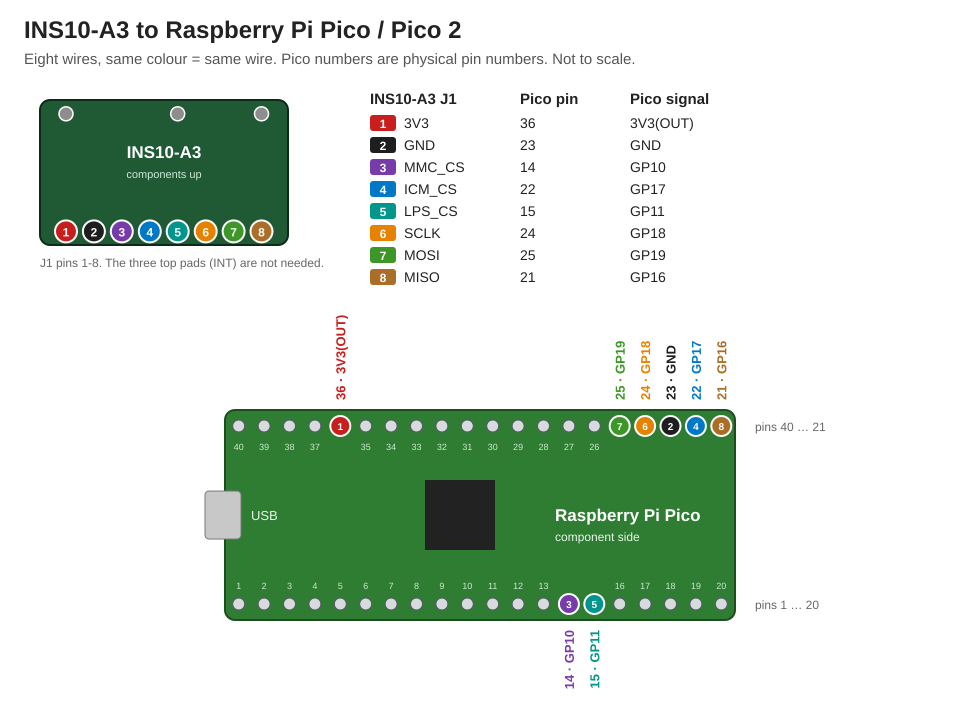
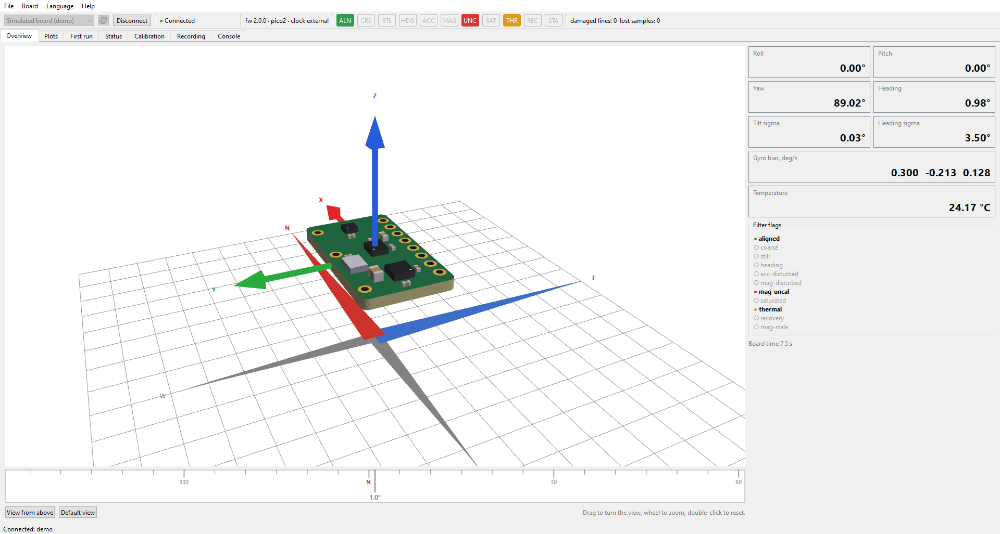
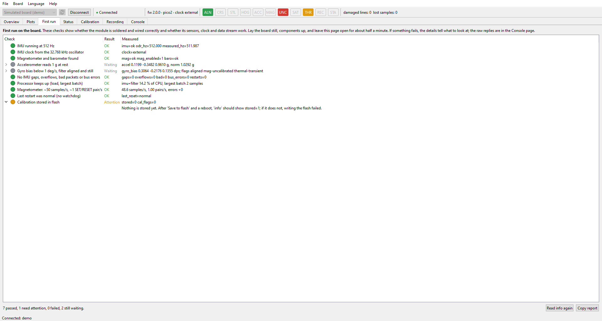
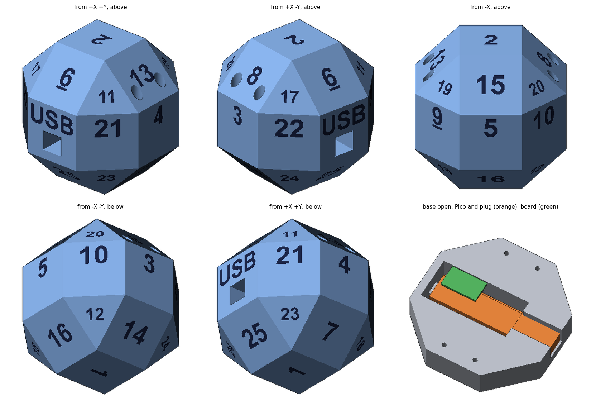
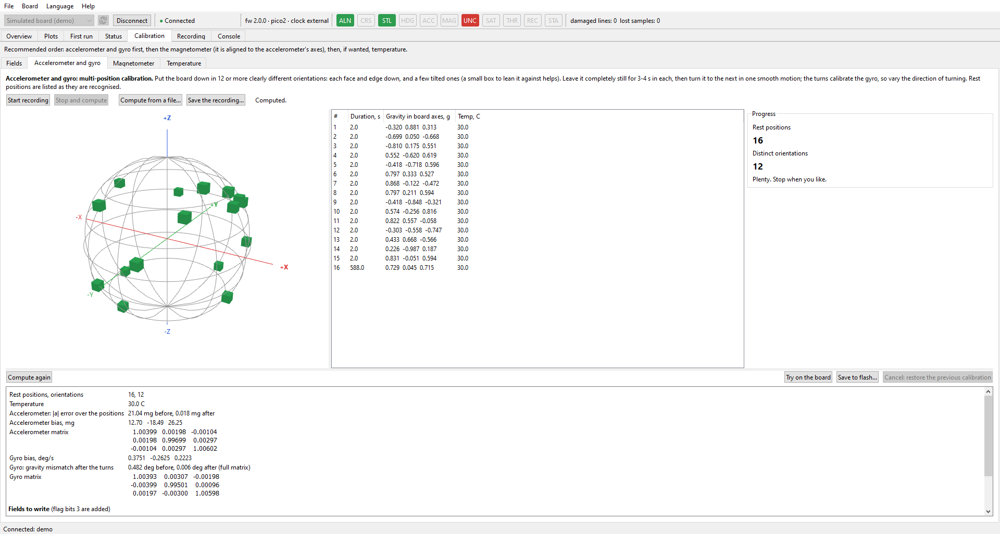
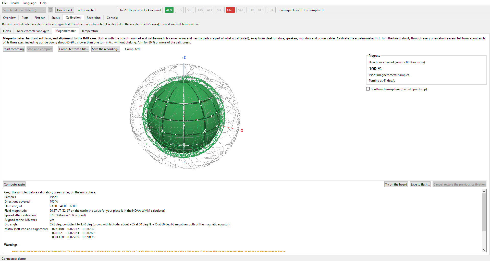

# INS10-A3 user guide

From a bare module to a calibrated orientation sensor: wiring it to a Raspberry Pi Pico, flashing the firmware, connecting INS10 Studio, calibrating with the printed jig, and reading the data from your own program.

[Українська версія](../uk/user-guide.md) · [Datasheet](datasheet.md) · [USB protocol](protocol.md)

## Contents

1. [What you get](#1-what-you-get)
2. [What else you need](#2-what-else-you-need)
3. [Safety and handling](#3-safety-and-handling)
4. [Wire the module to a Pico](#4-wire-the-module-to-a-pico)
5. [Flash the firmware](#5-flash-the-firmware)
6. [Install and connect INS10 Studio](#6-install-and-connect-ins10-studio)
7. [First-run checks](#7-first-run-checks)
8. [Print and assemble the calibration jig](#8-print-and-assemble-the-calibration-jig)
9. [Calibrate](#9-calibrate)
10. [Use the data](#10-use-the-data)
11. [Troubleshooting](#11-troubleshooting)
12. [Licences and support](#12-licences-and-support)

## 1. What you get

| Item | Form |
|---|---|
| INS10-A3 sensor module | Assembled and tested board, 22.5 × 13.2 mm, no header soldered |
| `ins10_ahrs` firmware 2.0.0 | UF2 files for Raspberry Pi Pico and Pico 2, plus source code |
| INS10 Studio | Windows app (zip, no installer), plus source code |
| Calibration jig | STL files to print, STEP and a parametric FreeCAD model |
| Documentation | This guide, the [datasheet](datasheet.md), the [USB protocol](protocol.md) |

Downloads: https://github.com/vdoom/boards/releases?q=ins10-a3. Everything except the module itself is free and open source.

## 2. What else you need

**Required**

- A Raspberry Pi Pico (RP2040) or Pico 2 (RP2350), with or without headers. The W (wireless) variants have not been tested.
- 8 thin wires, 5–8 cm long, or a 1×8 pin header and jumper wires.
- A soldering iron and solder.
- A USB cable that carries data (some phone cables are power-only).
- A PC with Windows 10 or 11, 64-bit, for INS10 Studio (tested on Windows 10). The firmware itself works with any computer that has a serial terminal.

**For calibration with the jig (recommended)**

- About 100 g of PLA or PETG and a 3D printer.
- 4 screws M3 × 16 with a cylinder head up to 6 mm. Brass or nylon is best; steel is acceptable.
- Thin double-sided tape (not foam tape).

## 3. Safety and handling

- **3.3 V only.** Power the module from the Pico's 3V3(OUT) pin. Anything above 3.6 V, including 5 V from USB or VSYS, destroys the sensors. The inputs are not 5 V tolerant.
- **Static electricity.** The sensors are sensitive to ESD. Touch a grounded object before handling the module, and hold it by its edges.
- **Do not bend the board** or drop it on a hard floor. MEMS sensors survive high shock, but bending the board while soldering or mounting can shift their offsets.
- **Keep the barometer port open.** The LPS22DF has a small hole on top. Keep glue, varnish, flux cleaner and liquids out of it.
- **Solder with USB disconnected**, and check for a short between 3V3 and GND before you plug it in.
- **Not for safety-critical use.** INS10-A3 is a development and hobby module. It is not certified for aviation, medical, automotive or any use where a failure could injure people.
- **Small parts.** Keep away from small children.
- **Disposal.** At the end of its life, take the module to an electronic waste collection point. Do not put it in household waste.

## 4. Wire the module to a Pico



Turn the module components up with the row of eight holes (J1) towards you: pin 1 is on the left. The Pico pin numbers below are physical pin numbers, counted as on the Raspberry Pi pinout: 1–20 down one side starting next to USB, 21–40 up the other.

| INS10-A3 | Signal | Pico pin | Pico signal |
|---|---|---:|---|
| J1.1 | 3V3 | 36 | 3V3(OUT) |
| J1.2 | GND | 23 | GND (any GND pin works) |
| J1.3 | MMC_CS | 14 | GP10 |
| J1.4 | ICM_CS | 22 | GP17 |
| J1.5 | LPS_CS | 15 | GP11 |
| J1.6 | SCLK | 24 | GP18 (SPI0 SCK) |
| J1.7 | MOSI | 25 | GP19 (SPI0 TX) |
| J1.8 | MISO | 21 | GP16 (SPI0 RX) |

The three single holes on the opposite edge (MMC_INT, ICM_INT, LPS_INT) are interrupt outputs. The supplied firmware does not need them. If you want them for your own code, the bench-test firmware uses GP12, GP20 and GP13.

**Tips**

- Keep the wires short: 5–8 cm is ideal, 10 cm at most.
- **If you will use the calibration jig**, put the wires in from the component side and solder them on the back. Then trim the joints on the back so that it is flat: the back is taped into the jig's lid, and the sensors face the Pico. The jig needs wires of at least 5 cm.
- Do not use the Pico's VBUS (pin 40) or VSYS (pin 39): they carry 5 V.
- After soldering, measure the resistance between J1.1 and J1.2 with USB disconnected. It must not be a short.

## 5. Flash the firmware

1. Download `ins10_ahrs-pico.uf2` for a Pico or `ins10_ahrs-pico2.uf2` for a Pico 2 from https://github.com/vdoom/boards/releases?q=ins10-a3.
2. Hold the **BOOTSEL** button on the Pico and plug in the USB cable. A drive named `RPI-RP2` (Pico) or `RP2350` (Pico 2) appears.
3. Copy the UF2 file onto that drive. The Pico restarts by itself, and the drive disappears.
4. Leave the module still for 2 seconds after power-up while the filter aligns. The Pico's LED blinks fast during alignment, then flashes briefly once a second.

To update the firmware later, repeat these steps, or send `bootsel` from INS10 Studio (**Board → Enter the USB bootloader**) instead of pressing the button. The calibration lives in its own flash sectors and normally survives firmware updates; export it first to be safe (section 9.4).

To build the firmware yourself, see [firmware/ins10-ahrs/README.md](../../firmware/README.md) (Pico SDK 2.2 or newer).

## 6. Install and connect INS10 Studio

1. Download `INS10-Studio-windows-x64.zip` from https://github.com/vdoom/boards/releases?q=ins10-a3 and unzip it into any folder, for example `C:\INS10 Studio`. There is no installer.
2. Run `ins10studio.exe`. Windows may show "Windows protected your PC" because the app is not code-signed: click **More info → Run anyway**.
3. Plug in the Pico. Pick its port in the list at the top left: Pico boards are listed first. Click **Connect**.

The top bar then shows the firmware version, the board (`pico` or `pico2`), `clock external`, and eleven status lamps:

| Lamp | Meaning when lit |
|---|---|
| ALN | Orientation initialised |
| CRS | Aligned while moving; tilt still converging |
| STL | Board at rest: the filter is refining the gyro bias |
| HDG | Heading locked to the magnetic field |
| ACC | Acceleration detected: accelerometer weight reduced |
| MAG | Magnetic disturbance detected: magnetometer weight reduced |
| UNC | Magnetometer not calibrated, so not used |
| SAT | Sensor saturation or lost samples in the last second |
| THR | Temperature transient in progress |
| REC | Divergence watchdog fired in the last 5 s |
| STA | No usable magnetometer samples for over a second |

On a new module, **UNC** is lit until you calibrate the magnetometer. Until then the heading starts from the direction at power-up and slowly drifts.

**Pages**

| Page | What it is for |
|---|---|
| Overview | The board in 3D over a compass plane; roll, pitch, yaw, heading, their uncertainties, gyro bias, temperature, filter flags |
| Plots | Angles, heading, gyro bias, temperature, raw gyro and accelerometer, field magnitude, barometric altitude. Pause and drag back in time; export what is visible to CSV |
| First run | Automatic health checks with a copyable report |
| Status | The firmware's `info` and `status` in tables, health counters, the learned temperature model |
| Calibration | Every calibration field, and the three calibration wizards |
| Recording | Record everything the board sends to a file; replay a recording through the firmware's own filter on the PC |
| Console | A terminal for the firmware's text commands |

The interface is in English and Ukrainian: switch in the **Language** menu at any time, without restarting.



**Without a board.** **Board → Connect the simulated board** starts a built-in simulator with realistic sensor errors. Use it to try the app and the wizards before your module arrives.

**Linux and macOS.** INS10 Studio is written in portable C++/Qt and has a build script for both, but only Windows has been tested so far. See [software/ins10-studio/README.md](../../studio/README.md).

## 7. First-run checks

Lay the module still, components up, and open the **First run** page for half a minute.



| Check | Expected |
|---|---|
| IMU running at 512 Hz | `imu=ok odr_hz=512.000` |
| IMU clock from the 32.768 kHz oscillator | `clock=external` |
| Magnetometer and barometer found | `mag=ok`, `baro=ok` |
| Accelerometer reads 1 g at rest | norm between 0.98 and 1.02 g |
| Gyro bias, filter aligned and still | bias under 1 °/s, flags `aligned still` |
| No IMU gaps, overflows, bad packets or bus errors | all zero |
| Processor keeps up | largest batch 10 samples or fewer |
| Magnetometer rate | about 50 samples/s, about 1 SET/RESET pair/s |
| Last restart was normal | `last_reset=normal` |
| Calibration stored in flash | `stored=1` after you calibrate and save; "Attention" on a new module is normal |

If a check fails, click **Copy report** and include the text when you ask for help.

## 8. Print and assemble the calibration jig

The jig is an 85 mm rhombicuboctahedron: a cube with all edges and corners cut off, which gives 26 flat faces. The module and the Pico sit inside, connected by their wires, and move as one. Faces 1–25 are numbered; the 26th face is where the USB cable comes out. Each numbered face is a stable resting position for calibration.



Files: [mechanical/calibration-jig](../../calibration-jig/) (`calibration-jig-base.stl`, `calibration-jig-lid.stl`).

**Printing**

- PLA or PETG, 0.2 mm layers, 3 perimeters, 15 % infill. Both parts together use about 100 g.
- **Base:** print as oriented in the file, with face 1 on the bed. Its number is engraved in the first layers, as intended.
- **Lid:** print as oriented in the file, flat side with the board recess on the bed.
- No supports are needed. If the module does not fit the recess, sand it lightly, or set `BOARD_CLEAR = 0.35` in `calibration_jig.py` and reprint the lid.

**Assembly**

1. Plug the USB cable into the Pico; leave the other end disconnected.
2. Put a strip of double-sided tape on the rail in the base.
3. Lay the lid on the table, recess up. Tape the module's bare back into the recess, sensors facing up (away from the lid). Point the J1 edge towards the middle of the lid, with J1.1 (3V3) towards the end of the recess nearer the centre: the wires are then shortest.
4. Turn the lid over: the module now faces down and the Pico hangs on its wires. Press the Pico onto the rail, USB towards the cable face, and lay the cable in its channel.
5. Fold the wires into the cavity, close the lid so the holes line up, check that no wire is pinched, and tighten the 4 screws gently: they cut their own thread in the plastic.

**Faces**

| Numbers | Faces | Cable |
|---|---|---|
| 1–5 | Square faces | Not in the way |
| 6–20 | Bevelled edges and corners | Leaves high above the table |
| 21–25 | Edges and corners next to the cable face | Bends sharply; a stiff cable can tip the jig. Skip these if it does |
| USB | Cable face | Do not rest on it |

The numbers are ordered so that any first few positions already point in all directions: just go 1, 2, 3 and so on.

## 9. Calibrate

Every MEMS sensor has offsets, scale errors and misalignments, and the magnetometer also sees the iron around it. Calibration measures them and stores the corrections in the Pico's flash. Do it in this order:

1. **Accelerometer and gyro**: required.
2. **Magnetometer**: required for compass heading.
3. **Temperature**: optional.

Each wizard records, shows progress live, computes, and shows a report with warnings. Nothing changes on the board until you choose:

- **Try on the board**: writes to RAM; the filter uses it immediately, and you can watch the result on Overview.
- **Save to flash...**: keeps it after power-off (asks for confirmation and lists the fields).
- **Cancel: restore the previous calibration**: puts back what the board had when the recording started.

Every wizard can also save its recording to a file and compute from a file later.

### 9.1 Accelerometer and gyro

**Calibration → Accelerometer and gyro → Start recording.**

1. Put the jig on face 1 on a firm table. Leave it completely still for 3–4 s.
2. Turn it in one smooth motion onto face 2, wait 3–4 s, then face 3, and so on.
3. Go through at least 12 faces; 20 is better, and 25 if your cable is flexible. The wizard counts rest positions and distinct orientations, and says when it has enough.
4. Click **Stop and compute**.



**Good result:** the accelerometer's |a| error after calibration is below 1 mg (typically 0.02–0.1 mg), and the gyro's gravity mismatch after the turns drops to about 0.1° or less. Click **Try on the board**, check that Overview looks right, then **Save to flash...**.

Without the jig, rest the bare module against a small box in 12 or more clearly different orientations; the jig just makes this faster and more repeatable.

If the table vibrates (PC fans, a washing machine nearby), the wizard finds fewer rest positions. Put the jig on a heavy object on a soft layer.

### 9.2 Magnetometer

Do this **away from computers, monitors, speakers, steel furniture and power cables**, ideally 1–2 m from anything metal. Calibrate the module **as it will be used**: the Pico, wires, screws and nearby parts are part of what is calibrated. If you later mount the module differently, repeat this step.

**Calibration → Magnetometer → Start recording.**

1. Hold the jig (or your device) in your hand.
2. Turn it slowly through every orientation: several full turns about each of the three axes, including upside down. Take 60–90 s, no faster than one turn in 6 seconds, without shaking.
3. Watch the sphere: aim for 80 % or more of the cells green.
4. Click **Stop and compute**.



**Check the report**

| Line | Good value |
|---|---|
| Directions covered | 80 % or more |
| Field magnitude | 22–67 µT on Earth; for your location, see the [NOAA magnetic field calculator](https://www.ngdc.noaa.gov/geomag/calculators/magcalc.shtml) |
| Spread after calibration | Below 1 %; up to 2 % is usable. More means the field was not uniform during recording |
| Aligned to the IMU axes | yes, **by a mirror image**. This is expected on INS10-A3: the magnetometer's Z axis points into the board ([datasheet](datasheet.md#axes)) |
| Dip angle | Positive in the northern hemisphere: about +65° at 50° N, +75° at 60° N. Negative south of the magnetic equator |

**Southern hemisphere:** tick **Southern hemisphere (the field points up)** before computing. In the northern hemisphere leave it unticked: a negative dip there means the wrong choice, and the heading would be 180° off.

Then **Try on the board**: the UNC lamp goes off and HDG lights up. Turn the board through 360° on the table and back: the heading should return to within a degree. **Save to flash...**

**True north.** Heading is magnetic until you set the magnetic declination for your place (from the NOAA calculator above, east positive). In **Calibration → Fields**, edit `declination`, click **Write to RAM**, then **Save to flash...**.

> Without Studio, the command-line tool in the firmware folder does the same: `python tools/ins10.py magcal`, with `--southern` in the southern hemisphere. It also reports the mirror image. Within about 10° of the magnetic equator neither tool can tell which way the field points; both warn, and the heading may then be 180° off, so check it against a compass.

### 9.3 Temperature (optional)

Gyro and accelerometer offsets change with temperature. The firmware learns the gyro's temperature dependence by itself whenever the board rests, so this step is optional. It gives a ready model at once and adds accelerometer compensation, which self-learning does not.

1. Cool the board: unpowered, in a closed bag, 20 minutes in a fridge.
2. Put it on a firm surface, connect it, start **Calibration → Temperature → Start recording**, and do not touch the board or the table.
3. Let it warm up for 15–30 minutes. A range of more than 15 °C is best; the wizard refuses less than 3 °C.
4. **Stop and compute**, then **Try on the board** and **Save to flash...**.

On one tested module, this reduced gyro bias drift between −12 and +25 °C from 0.24 °/s to 0.007 °/s.

### 9.4 Check and keep the calibration

- **Status** page: at rest in any position, the accelerometer norm is within 0.002 g of 1.
- **Calibration → Fields → Export JSON...** keeps a copy of the calibration on your PC; **Import...** brings it back, for example after **Erase...**.
- `info` (Console) shows `stored=1` and `cal_flags=31` when all five calibrations are stored (1 gyro, 2 accelerometer, 4 magnetometer, 8 and 16 temperature).

## 10. Use the data

### In INS10 Studio

- **Plots:** pick the curves, the time window (up to 10 min) and the raw data rate. **Pause** and drag to scroll back; **Export visible to CSV...** saves exactly what is on screen.
- **Recording:** choose what to record (`$RAW` at full rate, magnetometer, barometer) and save everything the board sends to a `.log` file. **Replay a log through the filter** runs the recording through the firmware's own filter code on the PC, so you can see what the board would output, and export it to CSV.
- **Console:** type any firmware command (see [protocol.md](protocol.md)), with history and a filter for stream lines.

### From your own program

The Pico appears as a USB serial port. Commands and data are plain text lines:

```text
> stream att 50
OK
$ATT,81234,0.999990,0.001200,-0.003100,0.002900,0.14,-0.36,0.33,89.67,0.2104,-0.1532,0.0871,0.03,0.21,31.42,00D
```

`$ATT` fields: time in ms, quaternion w, x, y, z (body to east-north-up), roll, pitch, yaw, heading (0–360°, clockwise from north), gyro bias x, y, z in °/s, tilt and heading 1σ in degrees, temperature in °C, status flags in hex. Full details: [protocol.md](protocol.md).

A minimal Python reader (needs `pip install pyserial`; replace `COM5` with your port, for example `/dev/ttyACM0` on Linux):

```python
import serial

with serial.Serial("COM5", 115200, timeout=1) as port:
    port.write(b"stream att 50\n")
    while True:
        line = port.readline().decode(errors="replace").strip()
        if not line.startswith("$ATT,"):
            continue
        f = line.split(",")
        roll, pitch, yaw, heading = map(float, f[6:10])
        flags = int(f[16], 16)
        print(f"roll {roll:7.2f}  pitch {pitch:7.2f}  heading {heading:6.1f}  flags {flags:03X}")
```

The firmware keeps sending at the last rate you set. `cal save` stores the current `$ATT` rate as the power-up rate (50 Hz by default).

### On your own microcontroller

The fusion code is a portable C11 library without dependencies or dynamic memory: [firmware/ins10-ahrs/lib/ins10](../../firmware/lib/ins10/). A usage example is at the top of `fusion.h`. Feed it gyro and accelerometer samples at a known rate and magnetometer samples when you have them; it returns the quaternion, angles, uncertainties and flags. The SPI drivers in `drivers/` are written for the Pico SDK but are short enough to port. Remember the magnetometer Z sign ([datasheet](datasheet.md#axes)).

### Limits of the filter

- A steady acceleration in one direction for more than about 30 s (a long acceleration run, a long banked turn) is eventually taken for tilt. Without an external speed reference such as GNSS, no AHRS can tell them apart.
- A steady magnetic disturbance that lasts more than a minute is accepted as the new local field; the heading then follows it.
- Without a calibrated magnetometer, a very slow, smooth rotation about the vertical axis (under 3 °/s) can be taken for gyro bias.
- The barometer is read and reported but not used in the orientation filter.

## 11. Troubleshooting

| Symptom | Cause and fix |
|---|---|
| No COM port appears | The cable is power-only, or the Pico is in BOOTSEL mode (it shows as a drive). Use a data cable; flash the firmware |
| Studio says "Not the AHRS firmware" | Another program is on the Pico. Flash `ins10_ahrs`. The Console page still works with other firmware |
| `imu=missing`, `mag=missing` or `baro=missing` in `info` | Wiring. Check 3V3 and GND first, then the CS line of the missing sensor, then SCLK/MOSI/MISO. Look for solder bridges |
| `clock=internal` | The IMU did not lock to the 32.768 kHz oscillator. The filter still works with the measured rate. Send `reboot`; if it persists, contact support with the First run report |
| Accelerometer norm far from 1 g at rest | The board is moving or vibrating, or it is not calibrated yet. Run the accelerometer and gyro wizard |
| STL lamp rarely lights at rest | The table vibrates. Use a heavy base on a soft layer |
| Heading 180° off, or the dip angle is negative in the northern hemisphere | The hemisphere was set wrongly in the magnetometer calibration (the Southern hemisphere box in Studio, `--southern` for `ins10.py`), or the calibration was made with an `ins10.py` from before 23 November 2026. Recalibrate with the right setting |
| Heading wanders, MAG lamp lights | Magnetic disturbance: steel, magnets, motors, a laptop nearby. Move away. If it happens everywhere, recalibrate as mounted |
| Heading is off by a constant few degrees | Declination not set, or the module is mounted rotated in your device |
| "lost samples" or "damaged lines" grow | USB trouble: try another cable or port, avoid unpowered hubs, close other programs that use the port, lower the plot raw data rate |
| Calibration gone after power-off | It was only tried, not saved. Use **Save to flash...**; `info` then shows `stored=1` |
| The Pico does not start, or gets warm | Power off at once and check for a short between 3V3 and GND |

## 12. Licences and support

**Open source.** The firmware and INS10 Studio are released under the MIT licence: you may use, modify and redistribute them, including in commercial products. The full text is in `LICENSE` in the repository.

**Third-party components**

| Component | Licence | Used in |
|---|---|---|
| Raspberry Pi Pico SDK, TinyUSB | BSD 3-Clause, MIT | Firmware |
| Qt 6 (Widgets, OpenGL, SerialPort) | LGPL v3, linked dynamically; the Qt DLLs can be replaced | INS10 Studio |
| Eigen 3.4 | MPL 2.0 | INS10 Studio |

**Support**

- Questions and bug reports: {{SUPPORT_EMAIL}}, or an issue at https://github.com/vdoom/boards/issues.
- Please include the First run report (**Copy report**) and, for calibration problems, the wizard's saved recording.

Manufacturer: {{SELLER_NAME}}, {{SELLER_ADDRESS}}.
