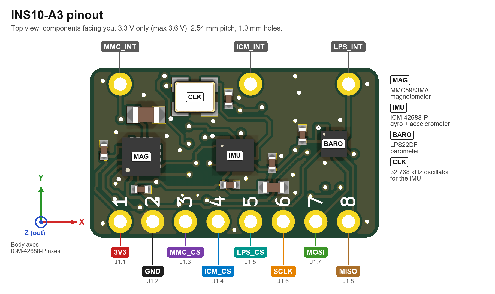

# INS10-A3: технічний опис

**Модуль орієнтації з 10 ступенями свободи: 3-осьовий гіроскоп, 3-осьовий акселерометр, 3-осьовий магнітометр і барометр на одній платі 22,5 × 13,2 мм, із зовнішнім тактовим генератором 32,768 кГц для IMU.**

Ревізія A3 · версія документа 1.0 · [English version](../en/datasheet.md)

*3D-рендер плати. Фото справжнього модуля — на сторінці товару.*

## Огляд

На INS10-A3 три сенсори на одній шині SPI:

- **ICM-42688-P** (TDK InvenSense): 6-осьовий IMU, тобто гіроскоп і акселерометр.
- **MMC5983MA** (MEMSIC): 3-осьовий магнітометр.
- **LPS22DF** (STMicroelectronics): датчик атмосферного тиску.

Генератор 32,768 кГц із виходом CMOS подає такт на вхід CLKIN IMU. Тоді IMU вимірює рівно 512 разів за секунду від опори з допуском ±25 ppm, а не від власного RC-генератора, тож інтегрування гіроскопа й мітки часу передбачувані.

Модуль підключається дротами до Raspberry Pi Pico або Pico 2 з відкритою прошивкою **ins10_ahrs**. Прошивка перетворює сирі дані на повну орієнтацію в 360° (кватерніон, крен, тангаж, рискання й компасний курс) і передає її через USB. **INS10 Studio** — настільний додаток для перегляду, перевірки й калібрування модуля. Сенсори можна читати й власним мікроконтролером: розпіновки й приміток щодо регістрів нижче для цього достатньо.

## Можливості

- Три сенсори, 10 вимірюваних осей: кутова швидкість, прискорення й магнітне поле за X, Y і Z, а також тиск. Кожен сенсор повідомляє ще й свою температуру.
- IMU тактується від зовнішнього генератора 32,768 кГц: частота даних рівно 512 Гц.
- 4-провідний SPI з трьома виборами мікросхем; три окремі виходи переривань.
- Живлення й логіка 3,3 В, без стабілізатора, підтягувальних резисторів і перетворювачів рівнів: мало деталей і мало шуму.
- 22,5 × 13,2 мм, два шари, наскрізні отвори з кроком 2,54 мм.
- Безкоштовна прошивка для Pico і Pico 2: розширений фільтр Калмана на 512 Гц, адаптивне відкидання прискорень і магнітних завад, відстеження зсуву гіроскопа, температурна компенсація, калібрування у flash.
- Безкоштовний додаток для Windows (INS10 Studio): 3D-вигляд наживо, графіки, перевірки справності, покрокові майстри калібрування, запис і відтворення.
- Підставка для калібрування під 3D-друк (STL) з 25 пронумерованими гранями.

## Характеристики

### Сенсори

| Сенсор | Мікросхема | Діапазон у прошивці | Роздільність | Головні числа з даташита виробника |
|---|---|---|---|---|
| Гіроскоп | ICM-42688-P | ±2000 °/с | 20 біт у FIFO, 0,0038 °/с на одиницю | Шум 2,8 м°/с/√Гц |
| Акселерометр | ICM-42688-P | ±16 g | 20 біт у FIFO, 30,5 мкg на одиницю | Шум 70 мкg/√Гц |
| Магнітометр | MMC5983MA | ±8 Гс (±800 мкТл) | 18 біт | Загальний шум 0,4 мГс СКВ; вбудований SET/RESET прибирає зсув моста |
| Барометр | LPS22DF | 260–1260 гПа | 24 біти | Абсолютна точність ±0,5 гПа, шум 0,34 Па СКВ |
| Такт IMU | ECS-327MVATX-3 | 32,768 кГц, CMOS | — | Загальний допуск ±25 ppm |

Мікросхеми мають і інші діапазони та частоти; у таблиці — те, що використовує прошивка з комплекту. Діапазон магнітометра значно ширший за поле Землі (25–65 мкТл), тож лишається запас на постійні зсуви від сусідніх деталей.

### Частоти даних з прошивкою ins10_ahrs

| Вихід | Частота |
|---|---|
| Вимірювання IMU (гіроскоп + акселерометр) | 512 Гц |
| Оновлення фільтра | 512 Гц |
| Потік орієнтації `$ATT` через USB | 0–200 Гц, типово 50 Гц |
| Сирі дані IMU `$RAW` | до 512 Гц (суми 1–1024 вибірок у рядку) |
| Магнітометр `$MAG` | близько 50 Гц, SET/RESET приблизно раз на секунду |
| Барометр `$BARO` | 25 Гц |

### Електричні

| Параметр | Значення |
|---|---|
| Напруга живлення | 3,3 В номінально. **Ніколи не вище 3,6 В**, включно з пульсаціями й викидами |
| Логічні рівні | 3,3 В CMOS. Входи не витримують 5 В |
| Струм споживання | Ще не виміряно. За даташитами сенсорів разом — кілька міліампер |
| Інтерфейс | SPI: режим 0 для магнітометра, режим 3 для IMU і барометра (див. [примітки щодо SPI](#примітки-щодо-spi)) |
| Частота SPI | До 10 МГц для всіх трьох мікросхем (лише IMU — до 24 МГц). Прошивка з комплекту працює на 1 МГц |
| Підтягування CS чи INT | Немає. Тримайте три лінії CS у високому рівні з боку контролера ще до першого обміну SPI |
| Конденсатори на платі | 8, зокрема 22 мкФ на виводі CAP магнітометра |

### Механічні й умови роботи

| Параметр | Значення |
|---|---|
| Контур | 22,5 × 13,2 мм, заокруглені кути |
| Товщина | Плата 1,6 мм; найвища деталь (конденсатор 0805) — близько 1,3 мм над нею |
| Контакти | J1: 8 наскрізних отворів з кроком 2,54 мм; J2–J4: по одному отвору (виходи INT). Отвори 1,0 мм, площадки 1,8 мм |
| Кріпильні отвори | Немає. Модуль кріпиться двостороннім скотчем або на впаяній гребінці |
| Робоча температура | −40…+85 °C (межа мікросхем сенсорів) |
| Отвір барометра | Відкритий отвір на корпусі LPS22DF. Не допускайте туди клею, лаку й рідин |

## Розпіновка

| Контакт | Сигнал | Напрям | Опис |
|---|---|---|---|
| J1.1 | 3V3 | Живлення | Живлення всіх трьох сенсорів і генератора |
| J1.2 | GND | Живлення | Земля |
| J1.3 | MMC_CS | Вхід | Вибір магнітометра, активний низький |
| J1.4 | ICM_CS | Вхід | Вибір IMU, активний низький |
| J1.5 | LPS_CS | Вхід | Вибір барометра, активний низький |
| J1.6 | SCLK | Вхід | Такт SPI, спільний |
| J1.7 | MOSI | Вхід | Дані SPI до сенсорів, спільні |
| J1.8 | MISO | Вихід | Дані SPI від сенсорів, спільні (невибрана мікросхема відпускає лінію) |
| J2 | MMC_INT | Вихід | Переривання магнітометра |
| J3 | ICM_INT | Вихід | INT1 IMU |
| J4 | LPS_INT | Вихід | Переривання барометра (DRDY) |

Прошивці ins10_ahrs потрібні лише вісім контактів J1; виходи переривань — за бажанням.

### Розміри

Усі координати в міліметрах від верхнього лівого кута контуру, вигляд згори, J1 унизу.

| Елемент | X | Y |
|---|---:|---:|
| Контур плати | 0 … 22,5 | 0 … 13,2 |
| J1.1 … J1.8 | 2,36 + 2,54 · (n − 1) | 11,95 |
| J2 (MMC_INT) | 2,36 | 1,25 |
| J3 (ICM_INT) | 12,52 | 1,25 |
| J4 (LPS_INT) | 20,14 | 1,25 |
| Центр ICM-42688-P | 11,30 | 6,80 |
| Центр MMC5983MA | 4,00 | 6,90 |
| Центр LPS22DF | 19,00 | 5,90 |

J2 і J1.1 мають однакову X, так само J4 і J1.8, тож обидва ряди лягають на сітку 2,54 мм.

## Осі

Плата лежить компонентами догори, J1 найближче до вас:

- **+X** дивиться праворуч, від магнітометра до барометра.
- **+Y** дивиться від вас, від J1 до площадок INT.
- **+Z** дивиться вгору, із боку компонентів.

Це осі ICM-42688-P, і прошивка використовує їх як зв'язану систему координат. Коли плата нерухомо лежить компонентами догори, акселерометр показує приблизно (0, 0, +1 g).

**Осі магнітометра.** Сирі осі X і Y MMC5983MA паралельні осям X і Y IMU, а вісь Z дивиться **в** плату. У MEMSIC вісь Z+ спрямована вниз, тож сира система магнітометра — дзеркальне відображення системи IMU: в осях IMU сире поле дорівнює `diag(1, 1, −1)`, помноженому на показ. Прошивка видає `$MAG` в осях самої мікросхеми; калібрування магнітометра в INS10 Studio чи `ins10.py magcal` знаходить це відображення і записує виправлення в матрицю магнітометра. Якщо пишете власний код, змініть знак Z магнітометра перед злиттям з IMU.

Така орієнтація випливає з даташитів мікросхем і поворотів посадкових місць на платі та збігається із записом справжнього модуля в 26 положеннях.

## Примітки щодо SPI

- **Магнітометр у режимі SPI 0.** У режимі 3 імпульс SET у MMC5983MA перемикає лише вісь X, а Y і Z лишаються в хибній полярності. Це відома особливість мікросхеми; у режимі 0 працюють усі осі. IMU і барометр працюють у режимі 3. Прошивка ins10_ahrs перемикає режим, коли всі лінії CS у високому рівні.
- **Зовнішній такт IMU.** Щоб використати генератор 32,768 кГц, установіть PIN9_FUNCTION = CLKIN (банк 1, регістр 0x7B, біти 2:1 = `10`) і RTC_MODE (банк 0, регістр 0x4D, біт 2 = 1), зберігши інші біти. Із зовнішнім тактом налаштування 500 Гц дає 512 Гц, а 1 кГц — 1024 Гц (частота множиться на 32,768 / 32). Не налаштовуйте вивід 9 IMU як вихід: на нього працює генератор.
- **Ідентифікатори мікросхем.** ICM-42688-P WHO_AM_I (0x75) = 0x47; MMC5983MA Product ID (0x2F) = 0x30; LPS22DF WHO_AM_I (0x0F) = 0xB4.
- **Проводка.** Дроти SPI мають бути короткими, бажано до 10 см. Хост має тримати всі три CS у високому рівні від увімкнення: на модулі підтягувань немає.

## Точність із прошивкою ins10_ahrs

**Симуляція.** Ці числа отримано тестами прошивки: справжній код фільтра працює на імітованих сенсорах із шумами ICM-42688-P і MMC5983MA. Останній рядок містить реалістичні залишки калібрування. Таблиця показує можливості алгоритму, а не гарантію для конкретного екземпляра.

| Сценарій | Похибка нахилу, СКВ / макс | Похибка курсу, СКВ / макс |
|---|---|---|
| Спокій | 0,006° / 0,02° | 0,008° / 0,02° |
| Безперервне перекидання до 150 °/с | 0,03° / 0,06° | 0,08° / 0,22° |
| Ривки 0,3 g і тряска 0,5 g | 0,08° / 0,25° | 0,11° / 0,28° |
| Магнітна завада 25 мкТл протягом 15 с | 0,02° / 0,06° | 0,17° / 0,50° |
| Широкосмугова вібрація 0,2 g | 0,32° / 0,56° | 0,26° / 0,53° |
| Усе разом із залишками калібрування | 0,28° / 0,72° | 0,71° / 1,75° |

**Виміряно на справжньому модулі** (один екземпляр, відкалібрований в INS10 Studio на надрукованій підставці):

| Величина | До калібрування | Після |
|---|---|---|
| Похибка модуля прискорення в 23 положеннях | 3,09 мg | 0,07 мg |
| Гіроскоп: розбіжність напрямку гравітації після поворотів | 0,65° | 0,08° |
| Дрейф зсуву гіроскопа в діапазоні −12…+25 °C (температурне калібрування) | 0,24 °/с | 0,007 °/с |
| Дрейф зсуву акселерометра в тому ж діапазоні | 8,7 мg | 0,12 мg |
| Розкид модуля поля після калібрування hard/soft iron, у приміщенні | — | 1,5 % |

Точність курсу на практиці залежить переважно від магнітного оточення: тримайте модуль подалі від сталі, двигунів, динаміків і силових кабелів і калібруйте його змонтованим.

## Граничні значення

| Параметр | Межа |
|---|---|
| Напруга живлення | −0,3…+3,6 В (найнижча межа — у магнітометра) |
| Напруга на будь-якому сигнальному контакті | −0,3 В … живлення + 0,3 В |
| Удар без живлення | 20 000 g протягом 0,2 мс (межа ICM-42688-P) |
| Температура зберігання | −40…+125 °C |

Перевищення цих меж може пошкодити модуль. MEMS-сенсори чутливі до статичної електрики й до згинання плати: тримайте за краї, не кидайте на тверду підлогу, не згинайте під час пайки.

## Програмне забезпечення

| Що | Де |
|---|---|
| Прошивка `ins10_ahrs` 2.0.0 для Pico (RP2040) і Pico 2 (RP2350), UF2 і сирці | [firmware/ins10-ahrs](../../firmware/) |
| INS10 Studio для Windows, програма й сирці | [software/ins10-studio](../../studio/) |
| Протокол USB | [PROTOCOL.md](../../firmware/docs/PROTOCOL.md) |
| Підставка для калібрування, STL і STEP | [mechanical/calibration-jig](../../calibration-jig/) |
| Початок роботи | [user-guide.md](user-guide.md) |

## Історія змін

| Ревізія | Дата | Зміни |
|---|---|---|
| A3 | 2026-10 | Генератор ECS 32,768 кГц; перша серійна ревізія |
| Документ 1.0 | 2026-11 | Перший публічний технічний опис |

Виробник: {{SELLER_NAME}}, {{SELLER_ADDRESS}}. Контакт: {{SUPPORT_EMAIL}}.
