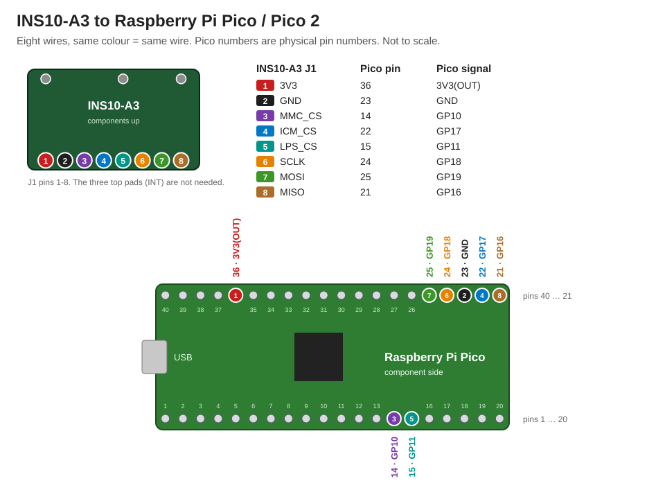
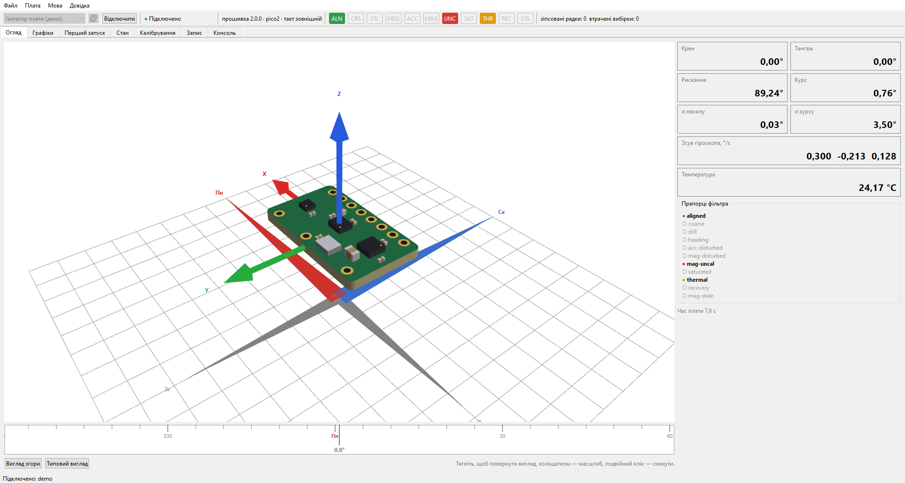
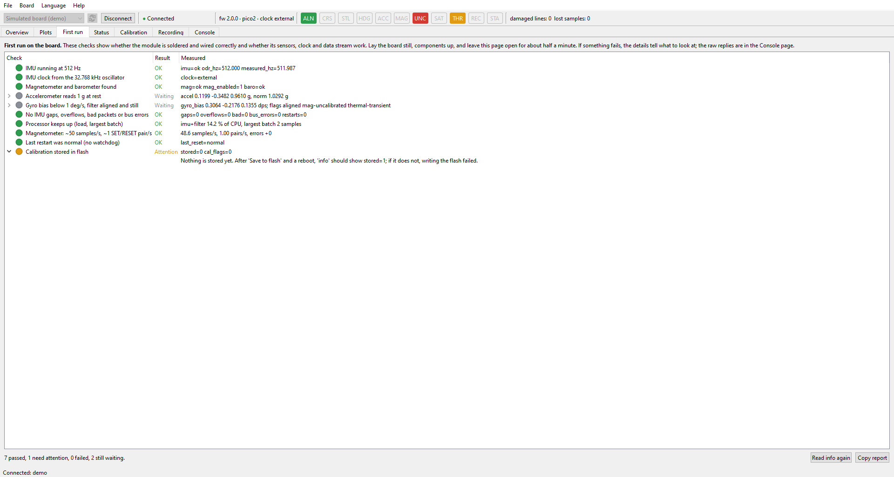
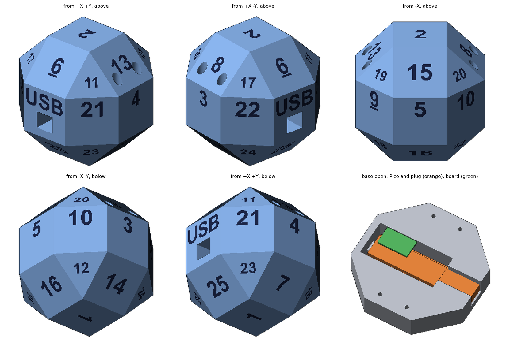
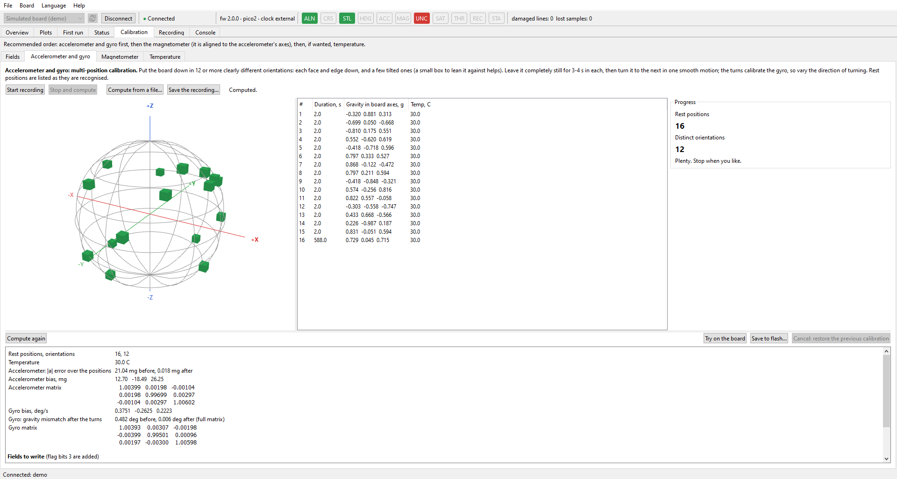
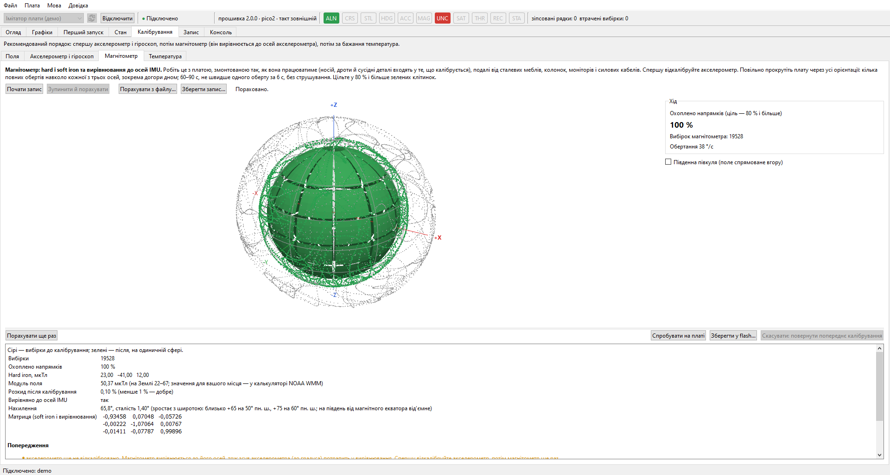

# INS10-A3: посібник користувача

Від голого модуля до відкаліброваного датчика орієнтації: підключення до Raspberry Pi Pico, прошивка, INS10 Studio, калібрування на надрукованій підставці й читання даних власною програмою.

[English version](../en/user-guide.md) · [Технічний опис](datasheet.md) · [Протокол USB](../../firmware/docs/PROTOCOL.md)

## Зміст

1. [Що ви отримуєте](#1-що-ви-отримуєте)
2. [Що ще знадобиться](#2-що-ще-знадобиться)
3. [Безпека й поводження](#3-безпека-й-поводження)
4. [Підключіть модуль до Pico](#4-підключіть-модуль-до-pico)
5. [Прошийте Pico](#5-прошийте-pico)
6. [Встановіть і підключіть INS10 Studio](#6-встановіть-і-підключіть-ins10-studio)
7. [Перевірки першого запуску](#7-перевірки-першого-запуску)
8. [Надрукуйте й зберіть підставку](#8-надрукуйте-й-зберіть-підставку)
9. [Відкалібруйте](#9-відкалібруйте)
10. [Використання даних](#10-використання-даних)
11. [Якщо щось не так](#11-якщо-щось-не-так)
12. [Ліцензії й підтримка](#12-ліцензії-й-підтримка)

## 1. Що ви отримуєте

| Що | У якому вигляді |
|---|---|
| Модуль INS10-A3 | Зібрана й перевірена плата 22,5 × 13,2 мм, без впаяної гребінки |
| Прошивка `ins10_ahrs` 2.0.0 | Файли UF2 для Raspberry Pi Pico і Pico 2, а також сирці |
| INS10 Studio | Програма для Windows (zip, без інсталятора), а також сирці |
| Підставка для калібрування | STL для друку, STEP і параметрична модель FreeCAD |
| Документація | Цей посібник, [технічний опис](datasheet.md), [протокол USB](../../firmware/docs/PROTOCOL.md) |

Завантаження: https://github.com/vdoom/boards/releases?q=ins10-a3. Усе, крім самого модуля, безкоштовне й з відкритим кодом.

## 2. Що ще знадобиться

**Обов'язково**

- Raspberry Pi Pico (RP2040) або Pico 2 (RP2350), з гребінками чи без. Варіанти W (з бездротовим зв'язком) не перевірялися.
- 8 тонких дротів завдовжки 5–8 см або гребінка 1×8 і дроти з роз'ємами.
- Паяльник і припій.
- Кабель USB, що передає дані (деякі кабелі від телефонів лише заряджають).
- ПК з Windows 10 або 11, 64 біти, для INS10 Studio (перевірено на Windows 10). Сама прошивка працює з будь-яким комп'ютером, де є термінал послідовного порту.

**Для калібрування на підставці (рекомендовано)**

- Близько 100 г PLA або PETG і 3D-принтер.
- 4 гвинти M3 × 16 з циліндричною головкою до 6 мм. Найкраще латунні або нейлонові; сталеві теж підійдуть.
- Тонкий двосторонній скотч (не спінений).

## 3. Безпека й поводження

- **Лише 3,3 В.** Живіть модуль від виводу 3V3(OUT) Pico. Будь-що понад 3,6 В, зокрема 5 В з USB чи VSYS, знищить сенсори. Входи не витримують 5 В.
- **Статична електрика.** Сенсори чутливі до розрядів. Перед роботою торкніться заземленого предмета й тримайте модуль за краї.
- **Не згинайте плату** і не кидайте її на тверду підлогу. MEMS-сенсори витримують сильні удари, але згинання плати під час пайки чи монтажу може змістити їхні нулі.
- **Отвір барометра має лишатися відкритим.** На корпусі LPS22DF є маленький отвір. Не допускайте туди клею, лаку, змивки флюсу й рідин.
- **Паяйте з від'єднаним USB** і перед підключенням перевірте, що між 3V3 і GND немає короткого замикання.
- **Не для відповідальних застосувань.** INS10-A3 — модуль для розробки й хобі. Він не сертифікований для авіації, медицини, автомобілів і будь-яких застосувань, де відмова може травмувати людей.
- **Дрібні деталі.** Зберігайте подалі від малих дітей.
- **Утилізація.** Наприкінці терміну служби здайте модуль у пункт збору електронних відходів, а не в побутове сміття.

## 4. Підключіть модуль до Pico



Поверніть модуль компонентами догори, рядом із восьми отворів (J1) до себе: контакт 1 ліворуч. Номери контактів Pico в таблиці — фізичні, як на розпіновці Raspberry Pi: 1–20 уздовж одного боку від роз'єму USB, 21–40 уздовж іншого у зворотному напрямку.

| INS10-A3 | Сигнал | Контакт Pico | Сигнал Pico |
|---|---|---:|---|
| J1.1 | 3V3 | 36 | 3V3(OUT) |
| J1.2 | GND | 23 | GND (підійде будь-який GND) |
| J1.3 | MMC_CS | 14 | GP10 |
| J1.4 | ICM_CS | 22 | GP17 |
| J1.5 | LPS_CS | 15 | GP11 |
| J1.6 | SCLK | 24 | GP18 (SPI0 SCK) |
| J1.7 | MOSI | 25 | GP19 (SPI0 TX) |
| J1.8 | MISO | 21 | GP16 (SPI0 RX) |

Три поодинокі отвори на протилежному краю (MMC_INT, ICM_INT, LPS_INT) — виходи переривань. Прошивці з комплекту вони не потрібні. Якщо вони знадобляться вашому коду, стендовий тест використовує GP12, GP20 і GP13.

**Поради**

- Дроти мають бути короткими: найкраще 5–8 см, щонайбільше 10 см.
- **Якщо будете калібрувати на підставці**, вставляйте дроти з боку компонентів, а паяйте зі зворотного боку. Потім обріжте виводи на звороті, щоб він був пласким: зворот приклеюється до кришки підставки, а сенсори дивляться на Pico. Дроти для підставки — щонайменше 5 см.
- Не використовуйте VBUS (контакт 40) і VSYS (контакт 39) Pico: на них 5 В.
- Після пайки, з від'єднаним USB, виміряйте опір між J1.1 і J1.2. Короткого замикання бути не повинно.

## 5. Прошийте Pico

1. Завантажте з https://github.com/vdoom/boards/releases?q=ins10-a3 файл `ins10_ahrs-pico.uf2` для Pico або `ins10_ahrs-pico2.uf2` для Pico 2.
2. Утримуючи кнопку **BOOTSEL** на Pico, під'єднайте кабель USB. З'явиться диск `RPI-RP2` (Pico) або `RP2350` (Pico 2).
3. Скопіюйте файл UF2 на цей диск. Pico сам перезапуститься, а диск зникне.
4. Після ввімкнення залиште модуль нерухомим на 2 секунди, поки фільтр вирівнюється. Світлодіод Pico під час вирівнювання часто блимає, потім коротко спалахує раз на секунду.

Щоб оновити прошивку пізніше, повторіть ці кроки або замість кнопки скористайтеся в INS10 Studio пунктом **Плата → Перейти в USB-завантажувач**. Калібрування лежить в окремих секторах flash і зазвичай переживає оновлення прошивки; про всяк випадок спершу експортуйте його (розділ 9.4).

Щоб зібрати прошивку самостійно, див. [firmware/ins10-ahrs/README.md](../../firmware/README.md) (Pico SDK 2.2 або новіший).

## 6. Встановіть і підключіть INS10 Studio

1. Завантажте `INS10-Studio-windows-x64.zip` з https://github.com/vdoom/boards/releases?q=ins10-a3 і розпакуйте в будь-яку теку, наприклад `C:\INS10 Studio`. Інсталятора немає.
2. Запустіть `ins10studio.exe`. Windows може показати попередження SmartScreen, бо програма не має цифрового підпису: натисніть **Докладніше** (More info), потім **Запустити все одно** (Run anyway).
3. Під'єднайте Pico. Виберіть його порт у списку вгорі ліворуч (плати Pico показано першими) і натисніть **Підключити**.

Мова інтерфейсу — українська або англійська, перемикається в меню **Мова** будь-коли, без перезапуску.

Верхня панель покаже версію прошивки, плату (`pico` чи `pico2`), `clock external` і одинадцять індикаторів:

| Індикатор | Що означає, коли світиться |
|---|---|
| ALN | Орієнтацію ініціалізовано |
| CRS | Вирівнювання в русі, нахил ще уточнюється |
| STL | Плата нерухома: фільтр уточнює зсув гіроскопа |
| HDG | Курс прив'язано до магнітного поля |
| ACC | Виявлено прискорення: вагу акселерометра знижено |
| MAG | Виявлено магнітну заваду: вагу магнітометра знижено |
| UNC | Магнітометр не відкалібровано, тому він не використовується |
| SAT | Насичення сенсора або втрата вибірок за останню секунду |
| THR | Триває температурний перехідний процес |
| REC | За останні 5 с спрацював сторож розбіжності |
| STA | Понад секунду немає придатних вибірок магнітометра |

На новому модулі **UNC** світиться, доки ви не відкалібруєте магнітометр. До того курс відлічується від напрямку на момент увімкнення й повільно дрейфує.

**Сторінки**

| Сторінка | Для чого |
|---|---|
| Огляд | Плата в 3D над компасною площиною; крен, тангаж, рискання, курс, їхні невизначеності, зсув гіроскопа, температура, прапорці фільтра |
| Графіки | Кути, курс, зсув гіроскопа, температура, сирі гіроскоп і акселерометр, модуль поля, барометрична висота. Пауза з прокручуванням назад; експорт видимого в CSV |
| Перший запуск | Автоматичні перевірки справності зі звітом, який можна скопіювати |
| Стан | Відповіді прошивки `info` і `status` таблицями, лічильники справності, вивчена температурна модель |
| Калібрування | Усі поля калібрування і три майстри |
| Запис | Запис усього, що надсилає плата, у файл; відтворення запису через фільтр самої прошивки на ПК |
| Консоль | Термінал для текстових команд прошивки |



**Без плати.** **Плата → Підключити імітатор плати** запускає вбудований імітатор із реалістичними похибками сенсорів. На ньому можна спробувати програму й майстри ще до того, як прийде модуль.

**Linux і macOS.** INS10 Studio написано переносним C++/Qt, є скрипт збирання для обох систем, але поки перевірено лише Windows. Див. [software/ins10-studio/README.md](../../studio/README.md).

## 7. Перевірки першого запуску

Покладіть модуль нерухомо, компонентами догори, і відкрийте сторінку **Перший запуск** на пів хвилини.



*Знімок з англійським інтерфейсом; українською сторінка така сама.*

| Перевірка | Очікується |
|---|---|
| IMU працює на 512 Гц | `imu=ok odr_hz=512.000` |
| Такт IMU від генератора 32,768 кГц | `clock=external` |
| Магнітометр і барометр знайдено | `mag=ok`, `baro=ok` |
| Акселерометр у спокої показує 1 g | норма від 0,98 до 1,02 g |
| Зсув гіроскопа, фільтр вирівняно, спокій | зсув менше 1 °/с, прапорці `aligned still` |
| Немає розривів, переповнень, зіпсованих пакетів і помилок шини IMU | усе нулі |
| Процесор устигає | найбільша порція не більше 10 вибірок |
| Частота магнітометра | близько 50 вибірок/с, близько 1 пари SET/RESET за секунду |
| Останній перезапуск звичайний | `last_reset=normal` |
| Калібрування збережено у flash | `stored=1` після калібрування й збереження; «Увага» на новому модулі — це нормально |

Якщо перевірка не пройшла, натисніть **Копіювати звіт** і додайте текст до звернення по допомогу.

## 8. Надрукуйте й зберіть підставку

Підставка — ромбокубооктаедр 85 мм: куб, у якого зрізано всі ребра й кути, тож він має 26 пласких граней. Модуль і Pico лежать усередині, з'єднані своїми дротами, і рухаються як одне ціле. Грані 1–25 пронумеровано; з 26-ї виходить кабель USB. Кожна пронумерована грань — стійке положення для калібрування.



Файли: [mechanical/calibration-jig](../../calibration-jig/) (`calibration-jig-base.stl`, `calibration-jig-lid.stl`). Докладний опис і зміна розмірів — у [README підставки](../../calibration-jig/README.md).

**Друк**

- PLA або PETG, шар 0,2 мм, 3 периметри, заповнення 15 %. Обидві деталі разом — близько 100 г.
- **Основа:** друкуйте як у файлі, гранню з номером 1 на стіл. Цифра на ній вигравірувана в перших шарах, так і має бути.
- **Кришка:** друкуйте як у файлі, пласким боком із заглибиною для плати на стіл.
- Підтримки не потрібні. Якщо модуль не лізе в заглибину, трохи підшліфуйте її або задайте `BOARD_CLEAR = 0.35` у `calibration_jig.py` і передрукуйте кришку.

**Збирання**

1. Вставте кабель USB у Pico; другий кінець поки не під'єднуйте.
2. Наклейте смужку двостороннього скотчу на рейку в основі.
3. Покладіть кришку на стіл заглибиною догори. Приклейте модуль голим зворотом у заглибину, сенсорами догори (від кришки). Край із J1 — до середини кришки, а кінець J1 з контактом J1.1 (3V3) — до кінця заглибини, ближчого до центру: так дроти найкоротші.
4. Переверніть кришку: модуль тепер дивиться вниз, Pico висить на дротах. Притисніть Pico до рейки роз'ємом USB до кабельної грані й покладіть кабель у канал.
5. Складіть дроти в порожнину, закрийте кришку так, щоб отвори збіглися, перевірте, що жоден дріт не затиснуто, і обережно закрутіть 4 гвинти: вони самі нарізають різьбу в пластику.

**Грані**

| Номери | Які грані | Кабель |
|---|---|---|
| 1–5 | Квадратні | Не заважає |
| 6–20 | Скошені ребра й кути | Виходить високо над столом |
| 21–25 | Ребра й кути поруч із кабельною гранню | Різко згинається; жорсткий кабель може підважити підставку. Тоді пропустіть ці грані |
| USB | Кабельна грань | На неї не класти |

Номери розставлено так, що будь-які перші з них уже дають положення в усіх напрямках: просто йдіть по порядку 1, 2, 3 і далі.

## 9. Відкалібруйте

Кожен MEMS-сенсор має зсуви, похибки масштабу й перекоси осей, а магнітометр ще й бачить залізо навколо. Калібрування вимірює їх і зберігає виправлення у flash Pico. Порядок:

1. **Акселерометр і гіроскоп** — обов'язково.
2. **Магнітометр** — обов'язково для компасного курсу.
3. **Температура** — за бажанням.

Кожен майстер записує дані, показує хід наживо, рахує і видає звіт із попередженнями. На платі нічого не змінюється, доки ви не виберете:

- **Спробувати на платі** — запис у RAM; фільтр одразу використовує результат, його видно на «Огляді».
- **Зберегти у flash...** — результат лишиться після вимкнення (з підтвердженням і переліком полів).
- **Скасувати: повернути попереднє калібрування** — повертає те, що було на платі на початку запису.

Кожен майстер уміє також зберегти запис у файл і порахувати з файлу пізніше.

### 9.1 Акселерометр і гіроскоп

**Калібрування → Акселерометр і гіроскоп → Почати запис.**

1. Покладіть підставку гранню 1 донизу на твердий стіл. Не торкайтеся її 3–4 с.
2. Одним плавним рухом переверніть на грань 2, зачекайте 3–4 с, потім грань 3 і так далі.
3. Пройдіть щонайменше 12 граней; краще 20, а якщо кабель м'який — 25. Майстер рахує положення спокою й різні орієнтації і скаже, коли їх достатньо.
4. Натисніть **Зупинити й порахувати**.



**Добрий результат:** похибка модуля прискорення після калібрування менша за 1 мg (зазвичай 0,02–0,1 мg), а розбіжність напрямку гравітації після поворотів падає приблизно до 0,1° або менше. Натисніть **Спробувати на платі**, перевірте «Огляд», потім **Зберегти у flash...**.

Без підставки спирайте голий модуль на невелику коробку в 12 і більше помітно різних положеннях; підставка лише робить це швидшим і повторюваним.

Якщо стіл вібрує (вентилятори ПК, пральна машина поруч), майстер знаходить менше положень спокою. Покладіть підставку на важкий предмет на м'якому шарі.

### 9.2 Магнітометр

Калібруйте **подалі від комп'ютерів, моніторів, колонок, сталевих меблів і силових кабелів**, бажано за 1–2 м від будь-якого металу. Калібруйте модуль **таким, яким він працюватиме**: Pico, дроти, гвинти й сусідні деталі входять у те, що калібрується. Якщо згодом змонтуєте модуль інакше, повторіть цей крок.

**Калібрування → Магнітометр → Почати запис.**

1. Візьміть підставку (або свій пристрій) у руку.
2. Повільно обертайте її через усі орієнтації: кілька повних обертів навколо кожної з трьох осей, зокрема догори дном. 60–90 с, не швидше одного оберту за 6 секунд, без струшування.
3. Стежте за сферою: цільте у 80 % зелених клітинок і більше.
4. Натисніть **Зупинити й порахувати**.



**Перевірте звіт**

| Рядок | Добре значення |
|---|---|
| Охоплено напрямків | 80 % і більше |
| Модуль поля | 22–67 мкТл на Землі; значення для вашого місця — у [калькуляторі магнітного поля NOAA](https://www.ngdc.noaa.gov/geomag/calculators/magcalc.shtml) |
| Розкид після калібрування | Менше 1 %; до 2 % придатно. Більше означає, що поле під час запису було неоднорідним |
| Вирівняно до осей IMU | так, **дзеркальним відображенням**. Для INS10-A3 так і має бути: вісь Z магнітометра дивиться в плату ([технічний опис](datasheet.md#осі)) |
| Нахилення | Додатне в північній півкулі: близько +65° на 50° пн. ш., +75° на 60° пн. ш. Від'ємне на південь від магнітного екватора |

**Південна півкуля:** перед розрахунком поставте позначку **Південна півкуля (поле спрямоване вгору)**. У північній півкулі не ставте її: від'ємне нахилення там означає хибний вибір, і курс буде зсунуто на 180°.

Потім **Спробувати на платі**: індикатор UNC згасне, засвітиться HDG. Поверніть плату на столі на 360° і назад: курс має повернутися в межах градуса. **Зберегти у flash...**

**Географічна північ.** Курс відлічується від магнітної півночі, доки ви не задасте магнітне схилення для свого місця (з калькулятора NOAA вище, на схід додатне). На вкладці **Калібрування → Поля** змініть `declination`, натисніть **Записати в RAM**, потім **Зберегти у flash...**.

> Без Studio те саме робить інструмент командного рядка в теці прошивки: `python tools/ins10.py magcal`, а в південній півкулі — з `--southern`. Він теж повідомляє про дзеркальне відображення. Ближче ніж приблизно 10° до магнітного екватора жоден із двох інструментів не може визначити, куди спрямоване поле. Обидва тоді попереджають, і курс може бути зсунутий на 180°, тож звірте його з компасом.

### 9.3 Температура (за бажанням)

Зсуви гіроскопа й акселерометра змінюються з температурою. Прошивка сама вивчає температурну залежність гіроскопа щоразу, коли плата нерухома, тож цей крок необов'язковий. Він одразу дає готову модель і додає компенсацію акселерометра, якої самонавчання не має.

1. Охолодіть плату: без живлення, у закритому пакеті, 20 хвилин у холодильнику.
2. Покладіть її на тверду поверхню, підключіть, запустіть **Калібрування → Температура → Почати запис** і більше не торкайтеся ні плати, ні столу.
3. Дайте прогрітися 15–30 хвилин. Найкраще набрати понад 15 °C; менше 3 °C майстер не прийме.
4. **Зупинити й порахувати**, потім **Спробувати на платі** і **Зберегти у flash...**.

На одному перевіреному модулі це зменшило дрейф зсуву гіроскопа в діапазоні −12…+25 °C з 0,24 °/с до 0,007 °/с.

### 9.4 Перевірка й збереження калібрування

- Сторінка **Стан**: у спокої в будь-якому положенні норма прискорення відрізняється від 1 g менш ніж на 0,002.
- **Калібрування → Поля → Експорт JSON...** зберігає копію калібрування на ПК; **Імпорт...** повертає її, наприклад після **Стерти...**.
- `info` (Консоль) показує `stored=1` і `cal_flags=31`, коли збережено всі п'ять калібрувань (1 гіроскоп, 2 акселерометр, 4 магнітометр, 8 і 16 температура).

## 10. Використання даних

### В INS10 Studio

- **Графіки:** виберіть криві, вікно часу (до 10 хв) і частоту сирих даних. **Пауза** і тягніть мишею назад у часі; **Експорт видимого в CSV...** зберігає саме те, що на екрані.
- **Запис:** виберіть, що записувати (`$RAW` на повній частоті, магнітометр, барометр), і збережіть усе, що надсилає плата, у файл `.log`. **Відтворити журнал через фільтр** проганяє запис через код фільтра самої прошивки на ПК: видно, що видала б плата, і це можна експортувати в CSV.
- **Консоль:** будь-яка команда прошивки ([протокол](../../firmware/docs/PROTOCOL.md)), з історією й фільтром рядків потоків.

### У власній програмі

Pico видно як послідовний порт USB. Команди й дані — звичайні текстові рядки:

```text
> stream att 50
OK
$ATT,81234,0.999990,0.001200,-0.003100,0.002900,0.14,-0.36,0.33,89.67,0.2104,-0.1532,0.0871,0.03,0.21,31.42,00D
```

Поля `$ATT`: час у мс, кватерніон w, x, y, z (зв'язана система → схід-північ-верх), крен, тангаж, рискання, курс (0–360°, за годинниковою стрілкою від півночі), зсув гіроскопа x, y, z в °/с, 1σ нахилу й курсу в градусах, температура в °C, прапорці стану в шістнадцятковому вигляді. Докладно — у [протоколі](../../firmware/docs/PROTOCOL.md).

Найпростіший читач на Python (потрібен `pip install pyserial`; замініть `COM5` своїм портом, на Linux це, наприклад, `/dev/ttyACM0`):

```python
import serial

with serial.Serial("COM5", 115200, timeout=1) as port:
    port.write(b"stream att 50\n")
    while True:
        line = port.readline().decode(errors="replace").strip()
        if not line.startswith("$ATT,"):
            continue
        f = line.split(",")
        roll, pitch, yaw, heading = map(float, f[6:10])
        flags = int(f[16], 16)
        print(f"roll {roll:7.2f}  pitch {pitch:7.2f}  heading {heading:6.1f}  flags {flags:03X}")
```

Прошивка надсилає дані з останньою заданою частотою. `cal save` запам'ятовує поточну частоту `$ATT` як частоту після ввімкнення (типово 50 Гц).

### На власному мікроконтролері

Код злиття даних — переносна бібліотека на C11 без залежностей і динамічної пам'яті: [firmware/ins10-ahrs/lib/ins10](../../firmware/lib/ins10/). Приклад виклику — на початку `fusion.h`. Подавайте їй вибірки гіроскопа й акселерометра з відомою частотою і вибірки магнітометра, коли вони є; вона повертає кватерніон, кути, невизначеності й прапорці. Драйвери SPI у `drivers/` написано для Pico SDK, але вони достатньо короткі, щоб їх перенести. Не забудьте про знак Z магнітометра ([технічний опис](datasheet.md#осі)).

### Межі фільтра

- Тривале прискорення в один бік довше приблизно 30 с (довгий розгін, тривалий віраж) фільтр зрештою сприйме як нахил. Без зовнішнього джерела швидкості, наприклад GNSS, жодна система орієнтації цього не розрізнить.
- Стала магнітна завада, що триває понад хвилину, приймається за нове місцеве поле; курс тоді слідує за нею.
- Без каліброваного магнітометра дуже повільне плавне обертання навколо вертикалі (менше 3 °/с) може бути прийняте за зсув гіроскопа.
- Барометр читається й видається, але у фільтрі орієнтації не використовується.

## 11. Якщо щось не так

| Ознака | Причина й що робити |
|---|---|
| Не з'являється COM-порт | Кабель лише для заряджання, або Pico у режимі BOOTSEL (видно як диск). Візьміть кабель для даних; прошийте Pico |
| Studio пише «Це не прошивка AHRS» | На Pico інша програма. Прошийте `ins10_ahrs`. «Консоль» працює й з іншою прошивкою |
| `imu=missing`, `mag=missing` або `baro=missing` в `info` | Проводка. Спершу перевірте 3V3 і GND, потім CS відсутнього сенсора, потім SCLK/MOSI/MISO. Шукайте перемички з припою |
| `clock=internal` | IMU не захопив такт генератора 32,768 кГц. Фільтр працює й так, з виміряною частотою. Надішліть `reboot`; якщо не минає, зверніться в підтримку зі звітом «Перший запуск» |
| Норма прискорення в спокої далека від 1 g | Плата рухається чи вібрує, або ще не відкалібрована. Пройдіть майстер акселерометра й гіроскопа |
| STL у спокої майже не світиться | Стіл вібрує. Покладіть підставку на важку основу на м'якому шарі |
| Курс зсунуто на 180° або нахилення від'ємне в північній півкулі | Під час калібрування магнітометра помилково задано півкулю (позначка «Південна півкуля» в Studio, `--southern` для `ins10.py`) або калібрували `ins10.py` версії до 23 листопада 2026. Перекалібруйте з правильним налаштуванням |
| Курс блукає, світиться MAG | Магнітна завада: сталь, магніти, двигуни, ноутбук поруч. Відійдіть. Якщо так усюди — перекалібруйте змонтований модуль |
| Курс відрізняється на кілька градусів постійно | Не задано схилення, або модуль у вашому пристрої змонтовано повернутим |
| Ростуть «lost samples» або «damaged lines» | Проблема USB: інший кабель чи порт, без пасивних хабів; закрийте інші програми, що відкривають порт; зменште частоту сирих даних на графіках |
| Після вимкнення калібрування зникло | Його лише спробували, а не зберегли. **Зберегти у flash...**; `info` тоді покаже `stored=1` |
| Pico не запускається або гріється | Негайно від'єднайте живлення й перевірте, чи немає замикання між 3V3 і GND |

## 12. Ліцензії й підтримка

**Відкритий код.** Прошивка й INS10 Studio поширюються за ліцензією MIT: їх можна використовувати, змінювати й поширювати, зокрема в комерційних виробах. Повний текст — у файлі `LICENSE` репозиторію.

**Сторонні компоненти**

| Компонент | Ліцензія | Де використовується |
|---|---|---|
| Raspberry Pi Pico SDK, TinyUSB | BSD 3-Clause, MIT | Прошивка |
| Qt 6 (Widgets, OpenGL, SerialPort) | LGPL v3, динамічне компонування; бібліотеки Qt можна замінити | INS10 Studio |
| Eigen 3.4 | MPL 2.0 | INS10 Studio |

**Підтримка**

- Питання й повідомлення про помилки: {{SUPPORT_EMAIL}} або issue на https://github.com/vdoom/boards/issues.
- Додайте звіт «Перший запуск» (**Копіювати звіт**), а для проблем із калібруванням — збережений запис майстра.

Виробник: {{SELLER_NAME}}, {{SELLER_ADDRESS}}.
