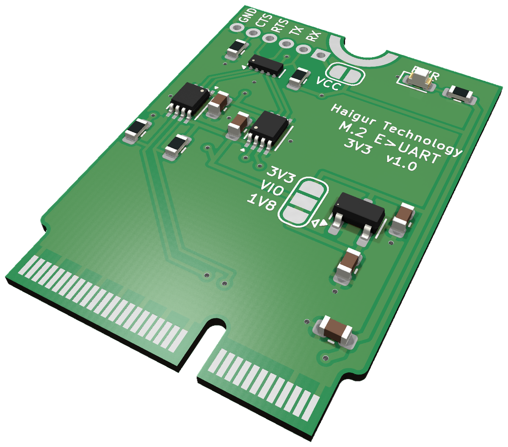
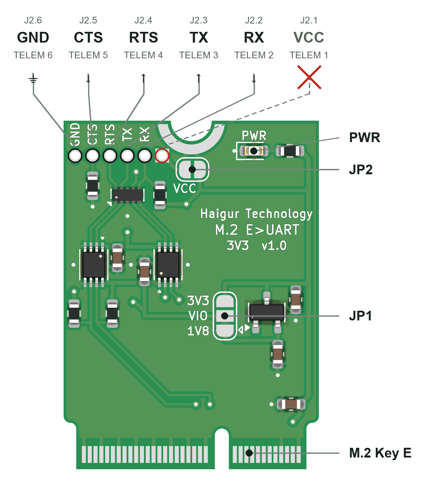
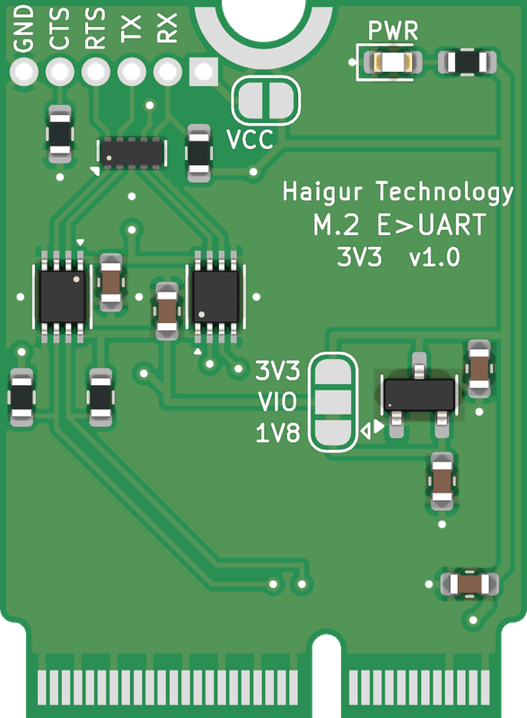
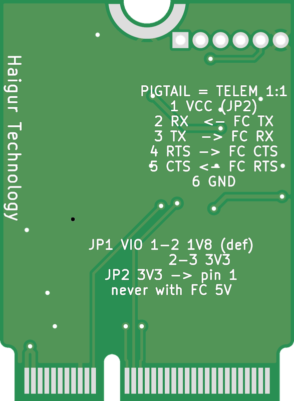

# M2-KeyE-UART v1.0: M.2 Key E to 3.3 V UART card for Jetson Orin

[All products](../README.md) · [Українська](README.uk.md)



An M.2 2230 Key E card that brings the Jetson's spare UART out to a flight controller. It goes into the M.2 Key E slot of the Jetson Orin Nano / Orin NX developer kit (carrier board P3768), translates the slot's 1.8 V UART to 3.3 V and ends in six solder pads numbered like a Pixhawk TELEM port: RX, TX, RTS, CTS and GND, pin for pin.

| | |
|---|---|
| Host | Jetson Orin Nano / Orin NX developer kit, carrier board P3768, JetPack 6. The M.2 Key E UART (`uartb`, 1.8 V) becomes `/dev/ttyTHS3` |
| Pigtail | 3.3 V UART with flow control: RX, TX, RTS, CTS, GND. Pixhawk TELEM levels; not 5 V tolerant |
| Speed | 921600 baud on a cable to a flight controller by default; up to about 3 Mbaud with RTS/CTS |
| Power | From the slot's 3.3 V, under 20 mA. Red PWR LED |
| Size | M.2 2230: 22 × 30 mm, 0.8 mm board, parts on the top side only, up to 1.2 mm high |

This guide is for **v1.0**, the card printed "v1.0", with jumpers JP1 and JP2 and six pigtail pads.

## Before you start

- On the developer kit, the M.2 Key E slot holds the Wi-Fi/Bluetooth card. This card takes its place, so the Jetson loses on-board Wi-Fi; a USB Wi-Fi adapter can replace it.
- The card is for a **1.8 V** UART in the slot, as on the P3768. Do not put it into a slot whose UART runs at 3.3 V.
- **Leave JP1 and JP2 as they are.** See [Jumpers](#jumpers).

## Pigtail pads



Top view, card edge down. Pad J2.1 is the square one, on the right, next to the screw notch. Arrows: up is out of the Jetson, down is into it.

| Pad | Name | Direction | Pixhawk TELEM pin |
|---|---|---|---|
| J2.1 | VCC | — | 1, +5 V **from** the flight controller: **leave unconnected** |
| J2.2 | RX | into the Jetson | 2 (FC TX) |
| J2.3 | TX | out of the Jetson | 3 (FC RX) |
| J2.4 | RTS | out of the Jetson | 4 (FC CTS) |
| J2.5 | CTS | into the Jetson | 5 (FC RTS) |
| J2.6 | GND | — | 6 (GND) |

The pads are numbered like the TELEM pins, so a straight cable works. Take a JST-GH 6-pin cable, cut off one connector, cut back and insulate the wire of pin 1 (+5 V), and solder wires 2–6 to pads J2.2–J2.6. Go by the pin numbers on the connector, not by wire colours: they differ between cables.

The pads are through-holes at 1.5 mm pitch with 0.7 mm drills. Solder the wires from the component side and lead them out past the screw end of the card. Check that the card with the wires fits under the Jetson module before you close everything up.

RTS and CTS are optional. Without them, the card holds CTS at "clear to send", so hardware flow control on the Jetson never blocks.

## Jumpers

- **JP1**, three pads next to the regulator labelled 3V3 / VIO / 1V8, sets the Jetson-side level. It leaves the factory at 1V8: the middle and bottom pads are joined by copper under the solder mask, so the link is not visible and the pads look separate. **Do not solder anything on JP1.** A bridge between the top and middle pads shorts the card's 1.8 V regulator to 3.3 V and drives 3.3 V into the Jetson's 1.8 V UART pins, which can damage the Jetson. Correct state, checked with a continuity tester: middle to bottom beeps, top to middle and top to bottom do not.
- **JP2**, two pads labelled VCC, is open. Bridged, it would connect the card's 3.3 V to pad J2.1, and with a TELEM cable the flight controller's +5 V would reach the Jetson's 3.3 V rail. **Keep JP2 open.**

## Jetson setup

NVIDIA's default device tree disables the M.2 Key E UART. The overlay [`jetson/m2-keye-uartb-overlay.dts`](jetson/m2-keye-uartb-overlay.dts) enables it with the high-speed UART driver and adds the alias `serial3`, so the port appears as `/dev/ttyTHS3`.

1. With the Jetson powered off, insert the card into the M.2 Key E slot and fix it with the slot screw. Power on: the red PWR LED on the card lights up.
2. Build the overlay and copy it to `/boot`:

   ```bash
   sudo apt install device-tree-compiler
   dtc -@ -I dts -O dtb -o m2-keye-uartb.dtbo m2-keye-uartb-overlay.dts
   sudo cp m2-keye-uartb.dtbo /boot/
   ```

3. In `/boot/extlinux/extlinux.conf`, inside the `LABEL` section you boot, add the line below. If jetson-io has already written an `OVERLAYS` line, add the file to it, separated by a space.

   ```
         OVERLAYS /boot/m2-keye-uartb.dtbo
   ```

4. Reboot and check:

   ```bash
   cat /proc/device-tree/bus@0/serial@3110000/status   # okay
   ls -l /dev/ttyTHS3
   dmesg | grep -i 3110000
   ```

If the status is still `disabled`, merge the overlay into the DTB and point `FDT` at the result:

```bash
fdtoverlay -i /boot/dtb/<your-kernel>.dtb -o /boot/dtb/<your-kernel>-m2uart.dtb m2-keye-uartb.dtbo
# extlinux.conf:  FDT /boot/dtb/<your-kernel>-m2uart.dtb
```

Fused and secure-boot units reject unsigned overlays and DTBs. On those, the change has to go into the signed DTB of the image you flash.

**JetPack 6.2.2 (r36.5)** has a DMA problem on the Orin high-speed UART: corrupted received data and SMMU faults in `dmesg`. NVIDIA's fix for `serial@3100000` is an `iommus = <&smmu_niso0 TEGRA234_SID_GPCDMA>;` entry on the UART node, or running the UART without DMA. Nobody has confirmed it for `serial@3110000`, which uses the same DMA controller. If you see garbage on RX under this release, apply the same fix to this node; the comment in the overlay file explains how.

## Loopback test

On the pigtail, connect TX to RX, and RTS to CTS if those wires are fitted. Then:

```bash
stty -F /dev/ttyTHS3 115200 raw -echo -crtscts      # crtscts if RTS-CTS is looped too
cat /dev/ttyTHS3 &
echo hello > /dev/ttyTHS3                            # "hello" must come back
kill %1
```

This checks the whole chain: Jetson → card → wire → card → Jetson. Repeat at 921600 or higher if you plan to run fast.

## Flight controller

- Wire it as in [Pigtail pads](#pigtail-pads), pin 1 unconnected.
- Use 921600 baud by default. The Orin UART tops out at 4.25 Mbaud, and NVIDIA quotes about 3 Mbaud as achievable on this UART. Above 921600, wire RTS/CTS and enable flow control on both ends. The card itself is not the limit.
- ArduPilot, for example on TELEM2: `SERIAL2_PROTOCOL = 2` (MAVLink2), `SERIAL2_BAUD = 921`, `BRD_SER2_RTSCTS = 0` without RTS/CTS wires or `1` with them.
- PX4: `MAV_1_CONFIG = TELEM 2`, `SER_TEL2_BAUD = 921600`.
- On the Jetson: mavlink-router, MAVROS or MAVSDK on `/dev/ttyTHS3` at the same speed.

## Circuit

- Two SN74LVC2T45 level translators, one per direction: TX and RTS out of the Jetson, RX and CTS into it.
- A 1.8 V regulator (XC6206) for the Jetson side, because the M.2 Key E slot has no 1.8 V supply.
- TPD4E05U06 ESD protection, 0.5 pF, on all four pigtail signals.
- 100 kΩ pull-ups and a pull-down keep every line at a defined level when the Jetson UART is disabled or the cable is unplugged.
- When the Jetson is off, the translators' pigtail side is high-impedance, so a powered flight controller sees open lines.
- The other way round, with the flight controller off and the Jetson on, TX and RTS can push a little current into it through its input protection diodes. On a drone both power up together; on the bench, power the flight controller first or at the same time.

M.2 contacts used: 22 to the Jetson's RX, 32 from the Jetson's TX, 34 to the Jetson's CTS, 36 from the Jetson's RTS; 3.3 V on 2 and 4; pin 18 and the rest of the ground contacts to GND.

## Dimensions

| | |
|---|---|
| Format | M.2 2230 Key E, 22 × 30 mm |
| Board | 0.8 mm, two layers, lead-free HASL |
| Parts | Top side only, up to 1.2 mm high; the back has no parts |
| Fixing | The slot screw, through the notch in the top edge |
| Pigtail pads | 6 through-holes, 1.5 mm pitch, 0.7 mm drill |

| Top | Bottom |
|---|---|
|  |  |

## Safety

- Insert and remove the card only with the Jetson powered off.
- Never connect TELEM pin 1 (+5 V) to the card.
- Only 3.3 V signals on the pigtail.
- Leave JP1 and JP2 as shipped.

## In this folder

| Path | What |
|---|---|
| `README.md`, `README.uk.md` | This guide |
| `jetson/m2-keye-uartb-overlay.dts` | Device-tree overlay: M.2 Key E UART → `/dev/ttyTHS3` |
| `images/` | Renders of the card and the pad diagram |
