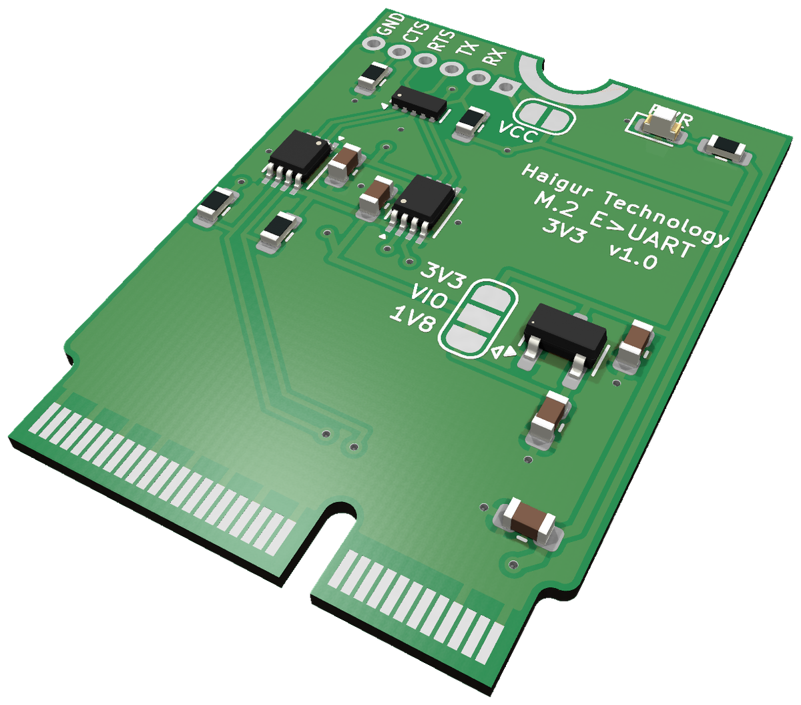
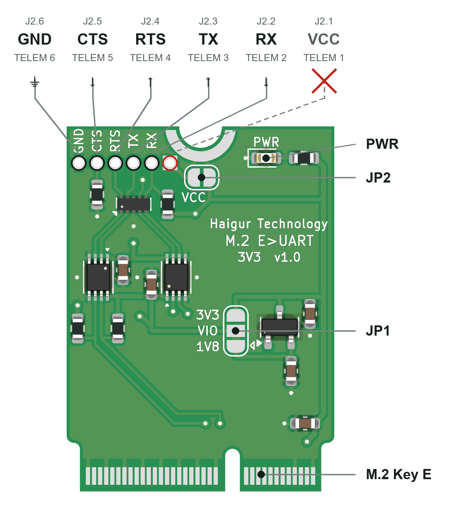
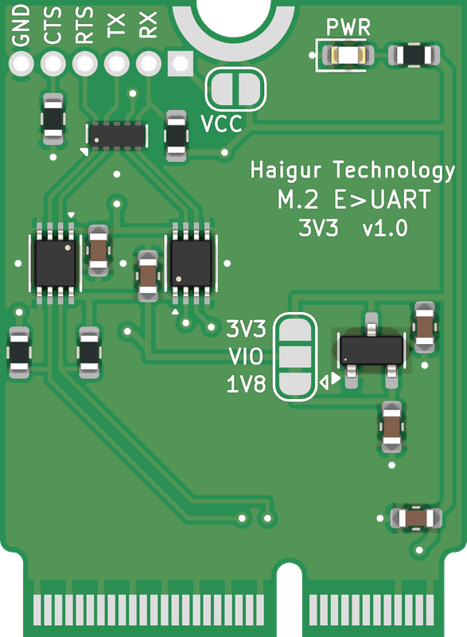
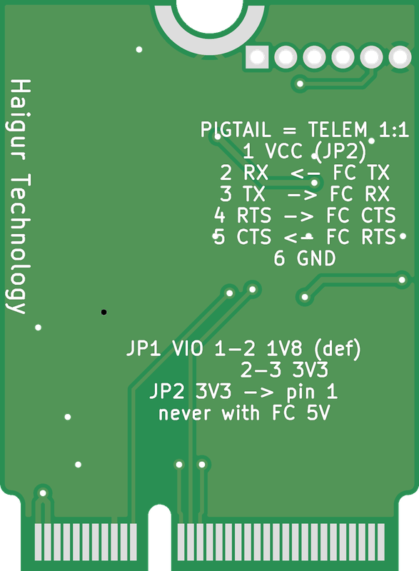

# M2-KeyE-UART v1.0: карта M.2 Key E → UART 3,3 В для Jetson Orin

[Усі продукти](../README.uk.md) · [English](README.md)



Карта M.2 2230 Key E, яка виводить вільний UART Jetson до польотного контролера. Вона встановлюється в слот M.2 Key E плати розробника Jetson Orin Nano / Orin NX (несуча плата P3768), перетворює UART слота з 1,8 В на 3,3 В і закінчується шістьма площадками під дроти, пронумерованими як порт TELEM Pixhawk: RX, TX, RTS, CTS і GND, контакт у контакт.

| | |
|---|---|
| Хост | Плата розробника Jetson Orin Nano / Orin NX, несуча плата P3768, JetPack 6. UART слота M.2 Key E (`uartb`, 1,8 В) стає `/dev/ttyTHS3` |
| Хвіст | UART 3,3 В з керуванням потоком: RX, TX, RTS, CTS, GND. Рівні як у TELEM Pixhawk; 5 В не витримує |
| Швидкість | 921600 бод на кабелі до польотного контролера за замовчуванням; приблизно до 3 Мбод з RTS/CTS |
| Живлення | Від 3,3 В слота, менше 20 мА. Червоний світлодіод PWR |
| Розмір | M.2 2230: 22 × 30 мм, плата 0,8 мм, компоненти лише згори, висотою до 1,2 мм |

Цей посібник для **v1.0** — карти з написом «v1.0», перемичками JP1 і JP2 та шістьма площадками хвоста.

## Перш ніж почати

- На платі розробника в слоті M.2 Key E стоїть карта Wi-Fi/Bluetooth. Ця карта займає її місце, тож вбудованого Wi-Fi у Jetson не буде; його може замінити USB-адаптер Wi-Fi.
- Карта розрахована на UART **1,8 В** у слоті, як на P3768. Не вставляйте її в слот, де UART працює на 3,3 В.
- **Не змінюйте JP1 і JP2.** Див. [Перемички](#перемички).

## Площадки хвоста



Вигляд згори, контакти M.2 внизу. Площадка J2.1 квадратна, праворуч, біля вирізу під гвинт. Стрілки: угору — з Jetson, униз — у Jetson.

| Площадка | Назва | Напрямок | Контакт TELEM Pixhawk |
|---|---|---|---|
| J2.1 | VCC | — | 1, +5 В **від** польотного контролера: **не підключати** |
| J2.2 | RX | у Jetson | 2 (TX контролера) |
| J2.3 | TX | з Jetson | 3 (RX контролера) |
| J2.4 | RTS | з Jetson | 4 (CTS контролера) |
| J2.5 | CTS | у Jetson | 5 (RTS контролера) |
| J2.6 | GND | — | 6 (GND) |

Площадки пронумеровано як контакти TELEM, тож підходить прямий кабель. Візьміть 6-контактний кабель JST-GH, відріжте один роз'єм, обріжте та заізолюйте провід контакту 1 (+5 В), а дроти 2–6 припаяйте до площадок J2.2–J2.6. Орієнтуйтеся на номери контактів на роз'ємі, а не на кольори дротів: у різних кабелях вони різні.

Площадки — металізовані отвори з кроком 1,5 мм і діаметром 0,7 мм. Паяйте дроти з боку компонентів і виводьте їх за край карти з боку гвинта. Перш ніж усе закрити, перевірте, що карта з дротами вміщається під модулем Jetson.

RTS і CTS не обов'язкові. Без них карта тримає CTS у стані «можна передавати», тож апаратне керування потоком на Jetson ніколи не блокує передачу.

## Перемички

- **JP1** — три площадки біля стабілізатора з написами 3V3 / VIO / 1V8 — задає рівень з боку Jetson. З заводу вона стоїть на 1V8: середню й нижню площадки з'єднано міддю під паяльною маскою, тож перемичку не видно, і площадки виглядають окремими. **Нічого не паяйте на JP1.** Перемичка між верхньою та середньою площадками замикає стабілізатор 1,8 В на 3,3 В і подає 3,3 В на виводи UART Jetson, розраховані на 1,8 В, — це може пошкодити Jetson. Правильний стан, якщо перевірити прозвонкою: середня з нижньою дзвонять, верхня із середньою і верхня з нижньою — ні.
- **JP2** — дві площадки з написом VCC — розімкнена. Якщо її замкнути, 3,3 В карти потрапить на площадку J2.1, а з кабелем TELEM +5 В польотного контролера потрапить на шину 3,3 В Jetson. **Залишайте JP2 розімкненою.**

## Налаштування Jetson

У стандартному дереві пристроїв NVIDIA UART слота M.2 Key E вимкнено. Оверлей [`jetson/m2-keye-uartb-overlay.dts`](jetson/m2-keye-uartb-overlay.dts) вмикає його з драйвером швидкого UART і додає псевдонім `serial3`, тож порт з'являється як `/dev/ttyTHS3`.

1. Вимкніть Jetson, вставте карту в слот M.2 Key E і закріпіть гвинтом слота. Увімкніть: на карті засвітиться червоний світлодіод PWR.
2. Зберіть оверлей і скопіюйте його в `/boot`:

   ```bash
   sudo apt install device-tree-compiler
   dtc -@ -I dts -O dtb -o m2-keye-uartb.dtbo m2-keye-uartb-overlay.dts
   sudo cp m2-keye-uartb.dtbo /boot/
   ```

3. У `/boot/extlinux/extlinux.conf`, у секції `LABEL`, з якої завантажуєтеся, додайте рядок нижче. Якщо jetson-io вже записав рядок `OVERLAYS`, допишіть файл у нього через пробіл.

   ```
         OVERLAYS /boot/m2-keye-uartb.dtbo
   ```

4. Перезавантажте й перевірте:

   ```bash
   cat /proc/device-tree/bus@0/serial@3110000/status   # okay
   ls -l /dev/ttyTHS3
   dmesg | grep -i 3110000
   ```

Якщо стан досі `disabled`, вбудуйте оверлей у DTB і вкажіть результат у `FDT`:

```bash
fdtoverlay -i /boot/dtb/<your-kernel>.dtb -o /boot/dtb/<your-kernel>-m2uart.dtb m2-keye-uartb.dtbo
# extlinux.conf:  FDT /boot/dtb/<your-kernel>-m2uart.dtb
```

Пристрої з пропаленими запобіжниками або захищеним завантаженням не приймають непідписані оверлеї й DTB. Там зміну треба внести в підписаний DTB образу, який ви прошиваєте.

**JetPack 6.2.2 (r36.5)** має проблему з DMA у швидкому UART Orin: пошкоджені прийняті дані й помилки SMMU в `dmesg`. Виправлення NVIDIA для `serial@3100000` — запис `iommus = <&smmu_niso0 TEGRA234_SID_GPCDMA>;` у вузлі UART або робота UART без DMA. Для `serial@3110000`, що використовує той самий контролер DMA, його ніхто не підтвердив. Якщо в цьому випуску на RX приходить сміття, застосуйте те саме виправлення до цього вузла; як саме — пояснює коментар у файлі оверлею.

## Перевірка петлею

На хвості з'єднайте TX з RX, а також RTS із CTS, якщо ці дроти є. Потім:

```bash
stty -F /dev/ttyTHS3 115200 raw -echo -crtscts      # crtscts, якщо RTS-CTS теж з'єднано
cat /dev/ttyTHS3 &
echo hello > /dev/ttyTHS3                            # має повернутися "hello"
kill %1
```

Так перевіряється весь ланцюжок: Jetson → карта → дріт → карта → Jetson. Якщо плануєте швидкий обмін, повторіть на 921600 бод або вище.

## Польотний контролер

- Підключайте, як у розділі [Площадки хвоста](#площадки-хвоста); контакт 1 не підключено.
- За замовчуванням — 921600 бод. UART Orin працює щонайбільше на 4,25 Мбод, а NVIDIA називає досяжними для цього UART приблизно 3 Мбод. Вище за 921600 підключіть RTS/CTS і ввімкніть керування потоком з обох боків. Сама карта швидкість не обмежує.
- ArduPilot, наприклад на TELEM2: `SERIAL2_PROTOCOL = 2` (MAVLink2), `SERIAL2_BAUD = 921`, `BRD_SER2_RTSCTS = 0` без дротів RTS/CTS або `1` з ними.
- PX4: `MAV_1_CONFIG = TELEM 2`, `SER_TEL2_BAUD = 921600`.
- На Jetson: mavlink-router, MAVROS або MAVSDK на `/dev/ttyTHS3` з тією самою швидкістю.

## Схема

- Два перетворювачі рівнів SN74LVC2T45, по одному на напрямок: TX і RTS з Jetson, RX і CTS у Jetson.
- Стабілізатор 1,8 В (XC6206) для боку Jetson, бо в слоті M.2 Key E немає живлення 1,8 В.
- Захист від ESD TPD4E05U06, 0,5 пФ, на всіх чотирьох сигналах хвоста.
- Підтягувальні резистори 100 кОм тримають кожну лінію на визначеному рівні, коли UART Jetson вимкнено або кабель від'єднано.
- Коли Jetson вимкнено, бік хвоста в перетворювачів переходить у високоімпедансний стан, тож увімкнений польотний контролер бачить розімкнені лінії.
- У зворотному випадку, коли контролер вимкнено, а Jetson увімкнено, TX і RTS можуть подавати на нього невеликий струм через його захисні діоди на входах. На дроні обидва вмикаються разом; на столі вмикайте контролер першим або одночасно.

Задіяні контакти M.2: 22 — до RX Jetson, 32 — від TX Jetson, 34 — до CTS Jetson, 36 — від RTS Jetson; 3,3 В на 2 і 4; контакт 18 та решта контактів землі — на GND.

## Розміри

| | |
|---|---|
| Формат | M.2 2230 Key E, 22 × 30 мм |
| Плата | 0,8 мм, два шари, безсвинцеве лудіння HASL |
| Компоненти | Лише згори, висотою до 1,2 мм; знизу компонентів немає |
| Кріплення | Гвинт слота, через виріз у верхньому краї |
| Площадки хвоста | 6 металізованих отворів, крок 1,5 мм, діаметр 0,7 мм |

| Згори | Знизу |
|---|---|
|  |  |

## Безпека

- Вставляйте й виймайте карту лише при вимкненому Jetson.
- Ніколи не підключайте до карти контакт 1 TELEM (+5 В).
- На хвіст — лише сигнали 3,3 В.
- Не змінюйте JP1 і JP2.

## Що в цій теці

| Шлях | Що це |
|---|---|
| `README.md`, `README.uk.md` | Цей посібник |
| `jetson/m2-keye-uartb-overlay.dts` | Оверлей дерева пристроїв: UART слота M.2 Key E → `/dev/ttyTHS3` |
| `images/` | Рендери карти й схема площадок |
